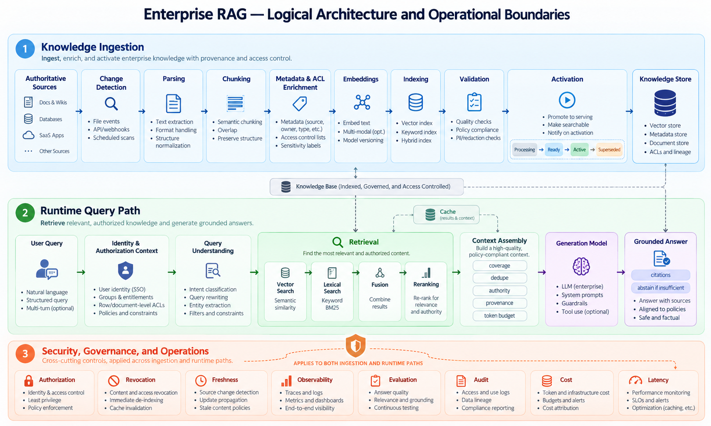
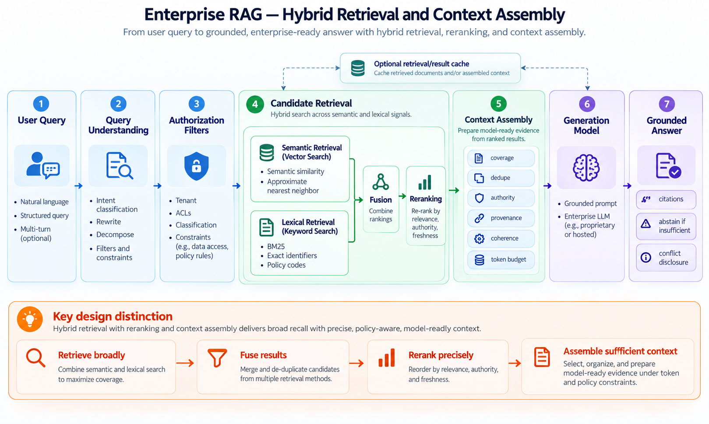
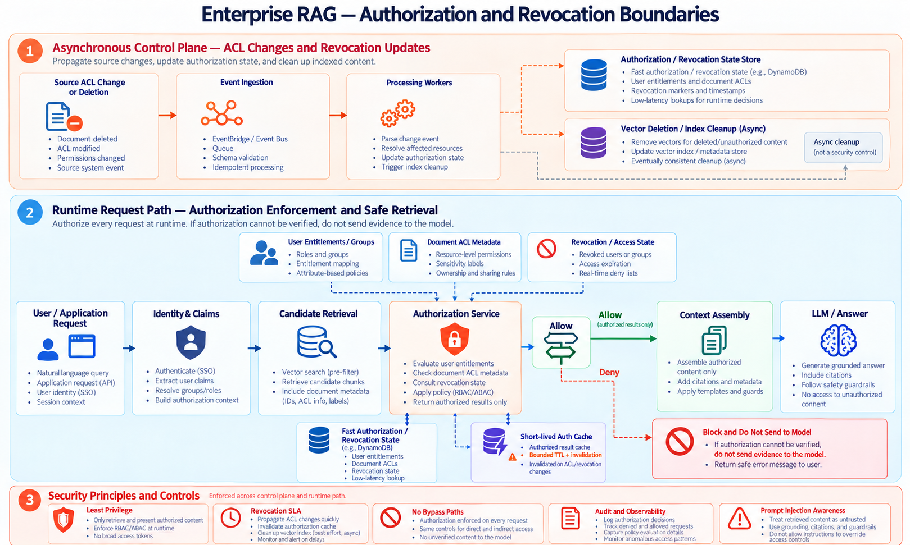
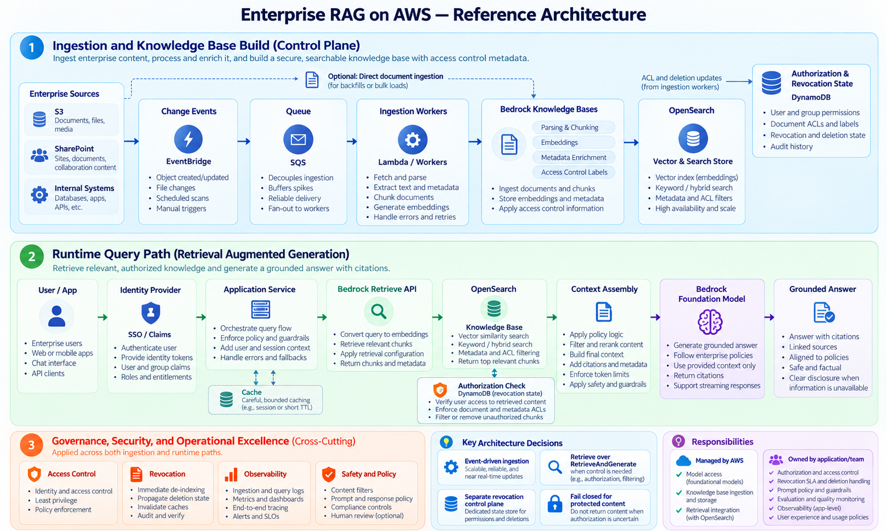

# Designing Production-Grade Enterprise RAG

*Architecture, trade-offs, and failure boundaries beyond the vector database and LLM*

Retrieval-augmented generation (RAG) is often introduced as a short sequence: split documents, create embeddings, retrieve relevant chunks, and ask a language model to answer. That is a useful demonstration. It is not yet an enterprise architecture.

An enterprise assistant must retrieve **the right information, for the right person, from the right version, at the right time**. A fluent answer is not necessarily an authorized, current, complete, or supported answer. The architecture therefore needs to treat ingestion, retrieval, authorization, evidence assembly, and generation as distinct responsibilities with independently observable failure modes.

This deep dive uses an enterprise architecture knowledge assistant as a running example. Employees query security policies, architecture standards, runbooks, and engineering documentation. Documents are updated, superseded, deleted, and access-controlled. The design principles apply beyond AWS or any particular model provider.

## The architectural problem

Assume the following illustrative requirements. They are design constraints for this case study, not measured results or service guarantees.

| Requirement | Working assumption |
| --- | --- |
| Corpus | 10 million documents |
| Change rate | Approximately 50,000 changed documents per day, with bursts |
| Knowledge freshness | New or changed content searchable within 15 minutes |
| Revocation | Deleted or access-revoked content must become inaccessible within 5 minutes |
| Security | Document-level access control; no cross-tenant disclosure |
| Answers | Grounded claims, verifiable citations, explicit uncertainty |
| Operations | Traceable failures, measurable quality, controlled latency and cost |

The first design choice is to stop treating RAG as one pipeline. There are three interacting systems: **knowledge ingestion**, **query-time retrieval and generation**, and **security/governance/operations** across both.

## 1. Knowledge ingestion is a versioned data-processing system

The ingestion path transforms authoritative source material into a derived retrieval representation:

**Sources → Change detection → Parsing → Chunking → Metadata → Embeddings → Indexing → Validation → Activation**

Each step can succeed independently of the others. A document may exist in the source but be absent from the index; its text may be parsed but its table relationships lost; embeddings may exist but not yet be searchable. The vector index is **not the system of record**.

### Preserve meaning before optimizing similarity

Parsing quality determines whether the source's meaning survives conversion. A table that originally associates *production* with *90 days* and *development* with *180 days* can become misleading if row relationships are lost. Chunking then determines whether a relevant rule and its exception remain discoverable together.

Fixed-size chunks are simple, but document-structure-aware or parent–child approaches may better preserve headings, clauses, and exceptions. Smaller chunks can improve retrieval precision; larger parent context can preserve meaning during generation. Neither strategy is universally superior. Evaluate against actual document types and questions.

Metadata is not decoration. Document identity, version, effective dates, lifecycle status, source authority, tenant, classification, and access-control references can determine whether a chunk is eligible for use. Incorrect metadata can hide correct evidence—or expose prohibited evidence.

### Updates are not automatically atomic

Suppose a security policy changes credential rotation from 180 days to 90 days. A naive update may leave both versions searchable. Worse, a newer document might produce 100 chunks while indexing fails after 73. Making those 73 chunks visible can create incomplete or contradictory answers.

For correctness-sensitive documents, use an explicit lifecycle:

**PROCESSING → READY → ACTIVE → SUPERSEDED**, with **RETRYING**, **FAILED**, and **QUARANTINED** states where appropriate.

Process the candidate version, verify completeness, and only then switch retrieval eligibility. Keep the previous version available until the new one is ready **provided the old version remains safe to serve**. If the old content has been revoked or is no longer authorized, deny access rather than preserving availability at the expense of security.

Activation should be designed as a controlled state transition, not assumed to be an atomic property of a vector store. Version checks also prevent an older, slower worker from overwriting a newer result. Stable document and chunk identifiers, content hashes, idempotent writes, and conditional updates help manage retries and out-of-order events.

### Asynchronous ingestion is a fit, not a guarantee

At the assumed change rate, an event-driven pipeline decouples source updates from parsing, embedding, and indexing. Durable queues absorb bursts; workers scale independently; retries isolate temporary downstream failures.

However, queue buffering introduces lag. The relevant measure is not merely queue depth, but **time from authoritative source change to retrieval-active knowledge**. Track oldest pending event age, processing failure rate, active document version, and freshness-SLO breaches. Separate high-priority deletion or ACL-change processing from routine content updates.

Full-document reprocessing is often safer when chunk boundaries can shift. Incremental processing works best when changed sections can be identified at stable content boundaries. Do not assume that a one-sentence edit means only one embedding must change.

## 2. Retrieval is a candidate-selection process

A query such as “How often should I change our prod DB password?” should find a policy stating “Production database credentials must be rotated every 90 days.” Semantic search handles wording differences; lexical search helps with exact identifiers such as `SEC-DB-104`.

A production retrieval path may combine:

1. Query understanding, rewriting, or decomposition where justified.
2. Tenant and authorization constraints before evidence is exposed.
3. Vector and lexical candidate retrieval.
4. Rank fusion, such as reciprocal rank fusion (RRF), where appropriate.
5. A more precise reranker over the candidate set.
6. Final evidence selection and context assembly.

**Fusion and reranking solve different problems.** Fusion combines results from retrieval methods whose raw scores may not be comparable. Reranking judges the relevance of candidate passages to the specific question. Retrieval Top-K and final context Top-K are separate parameters: the system might collect dozens of candidates but supply only a small, carefully selected evidence set to the model.

Approximate nearest-neighbor search also makes recall, latency, memory, and cost trade-offs. The presence of a correct embedding does not guarantee its chunk appears in a limited candidate set.

## 3. Context assembly is not simply taking the highest-ranked chunks

A question asking for *all* production credential requirements may require rotation, complexity, storage, privileged access, exceptions, and emergency procedures. A top-three list can be individually relevant and still incomplete.

Context assembly balances **coverage, coherence, authority, freshness, diversity, provenance, token budget, and cost**. It may expand a matched child chunk to its parent section, deduplicate overlapping passages, or perform additional retrieval for a missing subtopic.

Authority and recency must remain separate signals. An approved current security policy may require 90-day rotation while a still-published operations runbook says 180 days. A recently edited wiki may explain that the runbook is stale, but its freshness does not make it more authoritative than the policy.

For this case, the appropriate answer states the current 90-day policy, cites the authoritative clause, and discloses the conflicting runbook rather than silently hiding it. Where the supplied evidence cannot establish which source governs, the system should surface the conflict and abstain from an unsupported resolution.

Preserve provenance throughout: **source document → version/section → chunk → retrieved evidence → answer claim → citation**. A citation is only useful if the referenced evidence actually supports the associated claim.

## 4. Generation must remain grounded—and able to abstain

The model receives a user question, governing instructions, and an evidence package. Its task is to synthesize an answer **from authorized, applicable evidence**, not to invent missing enterprise facts.

A grounded answer may still be wrong: the model can overlook an exception, mix versions, misinterpret a table, or attach a plausible but incorrect citation. The application therefore needs an answerability policy. Strong authoritative evidence can support an answer; conflicts may require disclosure; missing support should trigger clarification, additional retrieval, or abstention.

Do not treat the model's self-reported confidence as a calibrated reliability score. Use observable signals such as evidence coverage, source authority, retrieval performance, contradiction detection, and citation support, and validate their predictive usefulness against evaluation data.

## 5. Authorization is a data-access boundary, not a prompt instruction

A vector store may consider a restricted incident report highly relevant to a query. Relevance never grants permission to use it. The retrieval service must constrain eligible content based on identity, tenant, document ACLs, classification, and current policy.

A layered approach can include coarse physical isolation for sensitive tenants or domains, authorization-aware retrieval filters, and authoritative checks before any candidate enters model context. These controls complement rather than replace one another. Physical isolation reduces blast radius but increases cost and management complexity; metadata filtering is efficient but depends on accurate, current ACL metadata.

**Stale access control is more dangerous than stale knowledge.** If a document's ACL changes while ingestion is backlogged, an old index filter may still permit it. Treat revocation propagation as a separate security SLO rather than relying on the content-freshness pipeline.

A fast revocation control plane can deny access before physical vector deletion finishes. Runtime checks should be synchronous for interactive requests, while ACL change propagation can be asynchronous provided it meets the revocation deadline. Batch checks by distinct document where possible; avoid a network call per chunk.

A cached ALLOW decision is itself an access-control risk. Cache lifetime, event propagation, group-membership changes, and invalidation delay must fit inside the revocation SLO. If required authorization state cannot be verified, fail closed for protected content. Restrict direct vector-store and knowledge-base API access so alternate paths cannot bypass the enforcement layer.

Retrieved content must also be treated as **untrusted input**. A document can contain instructions aimed at the model. Prompt-injection defenses and tool permissions must be enforced outside the model, particularly if the assistant later gains access to APIs or actions.

## 6. Evaluate each boundary independently

“The chatbot gave a wrong answer” is not an actionable diagnosis. The authoritative chunk might never have been parsed, indexed, retrieved, reranked, assembled, or interpreted correctly.

| Layer | Representative evaluation |
| --- | --- |
| Ingestion | Source-to-active lag, missing documents, partial failures, version correctness |
| Retrieval | Recall@K, precision, ranking quality, authorized candidate coverage |
| Reranking | Relevant evidence promoted or lost compared with initial candidates |
| Context | Required evidence coverage, conflict preservation, token efficiency |
| Generation | Correctness, groundedness, answer completeness, appropriate abstention |
| Citations | Claim-to-source support and provenance correctness |
| Security | Unauthorized context exposure, ACL lag, revocation deadline, bypass tests |
| Operations | Latency percentiles, errors, throttling, queue age, token and infrastructure cost |

Build a golden evaluation set containing exact identifiers, paraphrases, multi-document questions, historical questions, contradictory sources, unanswerable questions, and users with different permissions. Test pipeline changes—chunking, embeddings, vector settings, hybrid retrieval, reranking, prompts, and model choice—against that set rather than relying on a handful of successful demonstrations.

Production tracing should connect a request to candidate IDs, relevant document versions, retrieval/reranking decisions, authorized context, generation configuration, and citations. Protect sensitive prompts, retrieved text, identities, and traces through access controls and retention policies.

## 7. Map the architecture to AWS without confusing managed capability with ownership

A practical AWS starting point is **Amazon Bedrock Knowledge Bases** for supported ingestion and retrieval, a compatible vector store such as **Amazon OpenSearch**, Bedrock foundation models for generation, and an application layer for authorization and context control.

For change orchestration, EventBridge, SQS, Lambda, or Step Functions may connect enterprise change notifications to supported knowledge-base synchronization or direct ingestion APIs. DynamoDB can support a separate document revocation/access-state control plane, while IAM restricts direct access to knowledge-base and retrieval APIs. CloudWatch and application tracing provide operational evidence.

This is a **reference design**, not a claim that a particular Bedrock Knowledge Base configuration automatically satisfies atomic document activation, five-minute ACL revocation, or all custom ranking requirements. Exact features differ by knowledge-base type, data source, vector store, and API; validate current service behavior before selecting the configuration.

A useful decision is whether to use `RetrieveAndGenerate` for managed orchestration or `Retrieve` with application-controlled context assembly and generation. The latter can make source authority, authorization checks, conflict handling, and abstention more explicit, at the cost of additional engineering.

### Managed versus custom RAG

| Decision dimension | Managed knowledge-base approach | More custom pipeline |
| --- | --- | --- |
| Standard parsing, chunking, embedding | Less implementation ownership | More control and maintenance |
| Change processing | Supported sync/direct-ingestion boundaries | Custom event/state processing |
| Retrieval | Supported store and search features | Custom fusion, ranking, orchestration |
| Version activation | Must verify/supplement behavior | Explicitly designed lifecycle |
| Authorization | Application and connector capabilities must be validated | Custom policy enforcement still required |
| Evaluation | Custom tests and traces still necessary | Custom tests and traces still necessary |
| Cost/operations | Less pipeline code; managed service charges | Greater flexibility; greater ownership |

**Preferred starting decision:** use managed processing where it meets measured requirements, and build custom control only where the security, consistency, retrieval, or operational requirements justify it. Avoid building an entire ingestion framework merely because a managed API is not infinitely configurable.

### AWS-specific considerations to validate

- Supported connector ACL behavior and propagation timing; source permissions do not automatically imply equivalent knowledge-base retrieval permissions.
- Direct ingestion versus data-source synchronization interactions and source-of-truth consistency.
- Metadata filtering, hybrid search, and reranking support for the selected store/configuration.
- Region availability, throughput quotas, embedding/model choice, and total operating cost.
- DynamoDB regional availability and Global Tables replication/consistency semantics if the authorization plane is multi-region.
- IAM, encryption, audit, and direct-API bypass controls.

## 8. Architecture decisions and trade-offs

| Decision | Rationale | Cost or residual risk |
| --- | --- | --- |
| Event-driven ingestion | Decouple source changes and absorb bursts | Lag, retries, ordering, DLQ, monitoring |
| Version-aware activation | Prevent incomplete versions becoming authoritative | More state and lifecycle complexity |
| Hybrid retrieval + reranking | Improve coverage and precision across query types | Additional latency and cost |
| Explicit context assembly | Preserve completeness, authority, and citations | Additional application logic |
| External authorization | Keep security outside probabilistic model behavior | Runtime dependency, caching complexity |
| Separate revocation path | Enforce access changes independently of indexing | Another control plane to operate |
| Managed KB first | Reduce undifferentiated processing work | Must validate feature and consistency boundaries |
| Layered evaluation | Localize defects and justify tuning decisions | Evaluation datasets and ongoing maintenance |

## 9. Failure experiments before production approval

A proof of concept should intentionally test: an embedding outage with queued updates; out-of-order document versions; partial chunk indexing; source ACL revocation while ingestion is delayed; regional authorization-state lag; a bypass attempt through direct retrieval APIs; contradictory active sources; malicious instructions inside retrieved documents; and missing evidence that should cause abstention.

The system passes only when the observed behavior meets the relevant SLO and security requirement—not simply when the final response sounds plausible.

## Closing perspective

The difficult part of enterprise RAG is rarely the first embedding or the first model invocation. It is making knowledge **current, authorized, complete, traceable, and operationally trustworthy** while preserving acceptable latency and cost.

Treat ingestion as a versioned data pipeline, retrieval as evidence selection, context assembly as a correctness boundary, authorization as deterministic access control, and generation as the final synthesis step. That separation makes the architecture easier to evaluate, troubleshoot, evolve, and secure.

## References

- [Amazon Bedrock Knowledge Bases documentation](https://docs.aws.amazon.com/bedrock/latest/userguide/knowledge-base.html)
- [Retrieve API](https://docs.aws.amazon.com/bedrock/latest/APIReference/API_agent-runtime_Retrieve.html)
- [RetrieveAndGenerate API](https://docs.aws.amazon.com/bedrock/latest/APIReference/API_agent-runtime_RetrieveAndGenerate.html)
- [Knowledge Base data source synchronization](https://docs.aws.amazon.com/bedrock/latest/userguide/knowledge-base-ingest.html)
- [Amazon OpenSearch vector search](https://docs.aws.amazon.com/opensearch-service/latest/developerguide/vector-search.html)
- [DynamoDB Global Tables](https://docs.aws.amazon.com/amazondynamodb/latest/developerguide/GlobalTables.html)
- [OWASP Top 10 for LLM Applications](https://genai.owasp.org/llm-top-10/)
