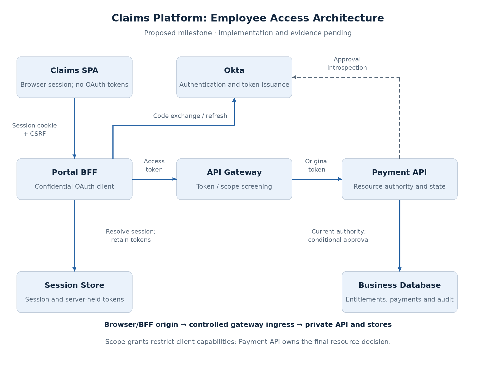

# Securing Employee Access to a Claims Payment Platform

A claims payment platform must let employees initiate, approve, and review payments while preserving account access and separation of duties. Central authentication provides a common identity model, but a successful login cannot establish whether a particular payment may be approved.

This deep dive combines the application and API security concepts into one employee-access architecture. It uses Okta for identity and token issuance, a BFF for browser sessions, and service-owned authorization for payment operations.

**Status:** proposed reference design. Implementation and validation are pending. Business limits below are illustrative requirements, not insurer regulations.

## Requirements and scope

The first milestone covers employee access. Partner APIs, automated settlement, and downstream delegation will extend the same system later.

| Employee responsibility | Required access | Restriction |
| --- | --- | --- |
| Initiator | Create and view payments | Assigned business units and accounts; no self-approval |
| Approver | Approve eligible payments | Assigned accounts, approval limit, and distinct initiator |
| Auditor | Read payment records and audit evidence | Explicit audit scope; no mutation |

For the reference transaction, an initiator creates a **USD 12,000** payment from Account East. An approver has a **USD 25,000** limit and access to that account. Both belong to the Auto Insurance business unit. Commercial Insurance provides a separate visibility boundary for isolation tests.

The architecture must also provide:

- **Browser token isolation:** OAuth tokens remain outside frontend JavaScript.
- **Current authority:** sensitive operations check authoritative application entitlements.
- **Transaction integrity:** approval applies to the evaluated amount, beneficiary, account, and version.
- **Protected ingress:** alternate permitted paths retain service authorization.
- **Auditability:** evidence identifies the subject, client, payment version, action, and result.

No throughput or availability target has been established. The design explains scaling and failure behavior without presenting an unmeasured capacity or production SLO.

## Selected architecture

| Component | Owns |
| --- | --- |
| Claims SPA | Employee workflows and display; no OAuth-token storage |
| Portal BFF | Confidential OAuth client, browser session, token refresh, allowed API forwarding |
| Okta | Authentication, client registration, group eligibility, scope issuance |
| API gateway | Initial token/scope checks, routing and traffic controls |
| Payment API | Independent credential checks, current authority, payment transitions |
| Shared session store | BFF sessions and server-held tokens |
| Business database | Subject mapping, entitlements, payments and audit records |

Serve the SPA and BFF through the same public origin. Keep the Payment API and stores behind controlled ingress. The BFF forwards the original Payment API access token through the gateway; the API validates it independently.

The session store is logically separate from business data. Its failure affects browser continuity, while business-data failure prevents authoritative payment decisions. Technology choices and deployment details belong in the lab specification.

## Identity and authorization contract

The BFF uses **Authorization Code + PKCE**, with confidential-client authentication. It validates the authentication response and establishes an opaque browser session.

Okta eligibility groups support read/create/approve issuance rules. They need not appear in the token. The application resolves the validated issuer and subject to a stable internal identity and retrieves current business rights.

| Operation | Token capability | Business enforcement |
| --- | --- | --- |
| Read payment | `payment:read` | Business-unit/account visibility and allowed fields |
| Create payment | `payment:create` | Current create permission and claim/account access; server records initiator |
| Approve payment | `payment:approve` | Current approve permission, account, limit, distinct initiator, state/version |
| Read audit evidence | `payment:read` | Additional application audit permission and resource visibility |

Read access is requested at login. Additional workflow capabilities are requested as needed. A failed scope request must not be treated as permission, and successful scope acquisition does not prove stronger authentication.

## Critical flows

### Login and API access

1. The BFF initiates login and binds the callback to the browser's login transaction.
2. Okta authenticates the subject and evaluates the requested grant.
3. The BFF exchanges the code and retains tokens server-side.
4. The browser receives a protected session cookie and invokes BFF routes.
5. Gateway and API validate the forwarded access token; the API applies business rules.

### Approval

The API performs local token/scope checks and requires **uncached introspection** for issuer activity status. A successful status check is followed by current entitlement and persisted-payment evaluation.

Commit approval only while the relevant payment version and eligible state hold. Concurrent entitlement changes also require a defined transaction/locking or version strategy; a payment-version check alone does not protect an entitlement race. Record the approval and its audit event atomically.

### Access removal

Removing an account entitlement blocks subsequent approvals when the API observes the authoritative update. An already-issued token may remain valid. Revoking the token addresses issuer status; it does not replace account authorization.

The lab must establish the ordering of concurrent revocation and approval. This design does not claim instantaneous access removal across all in-flight requests.

## Trade-offs and failure behavior

BFF isolates OAuth tokens from JavaScript but adds proxy capacity and shared session state. Gateway/service validation repeats credential work but protects approved alternate ingress paths. Runtime entitlements reduce reliance on token snapshots but add a database dependency. Approval introspection improves status freshness but places Okta on that operation's request path.

| Failure | Required outcome |
| --- | --- |
| Session cannot be resolved | No protected BFF operation; distinguish expiry from outage |
| Token inactive | Credential rejected |
| Required introspection unavailable | Approval does not proceed; no local-only fallback |
| Business authority unavailable | No approval based on unknown rights |
| Payment changed before commit | Stale approval rejected |
| Timeout after possible commit | Reconcile state before retrying; defined idempotency behavior |

Routine reads can continue with locally verifiable tokens and available business data during an Okta interruption, subject to key-cache policy. This deliberately differs from the approval policy.

## Scaling and operations

Scale BFF and gateway instances independently. Shared sessions allow BFF instance replacement, while refresh coordination prevents concurrent requests from losing rotated token state. API capacity depends on verification cost, entitlement queries, and transaction contention; measure those paths separately.

Track session failures, token/scope rejections, introspection latency, entitlement latency, approval conflicts, and dependency errors. Correlation connects request handling to the business audit result. Credentials must not appear in logs or evidence.

## Decisions and validation

The [proposed ADRs](claims-employee-access-adrs.md) capture the employee baseline and conditional machine, delegation, and trust-lifecycle extensions. None is marked implementation-validated. The baseline forwards the original JWT; Phantom Token resolution is an optional variant and must not weaken the fresh approval-status requirement.

The integrated lab will test selected properties: server-held tokens, denied unauthorized approval, entitlement removal with a valid token, revoked-token detection, dependency failure, and stale-transaction rejection. Partner and settlement identities extend this same platform after the employee milestone. Token exchange, step-up, sender constraints, and security events require provider capability checks before implementation; they are not prerequisites for the first build.

## Supporting concepts

- [Identity and Access Foundations](../../security/content.md)
- [Scopes, Groups, and API Access Decisions](../../security/scopes-and-api-access.md)
- [Browser Token and Session Architecture](../../security/browser-session-architecture.md)
- [Gateway and API Enforcement Boundaries](../../security/gateway-api-enforcement.md)
- [JWT Validation, Introspection, and Revocation](../../security/token-validation-revocation.md)
- [Step-Up Authentication](../../security/step-up-authentication.md)
- [Client Credentials and Machine Identity](../../security/client-credentials-machine-identity.md)
