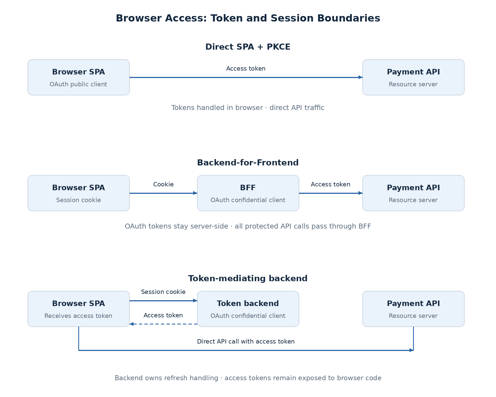
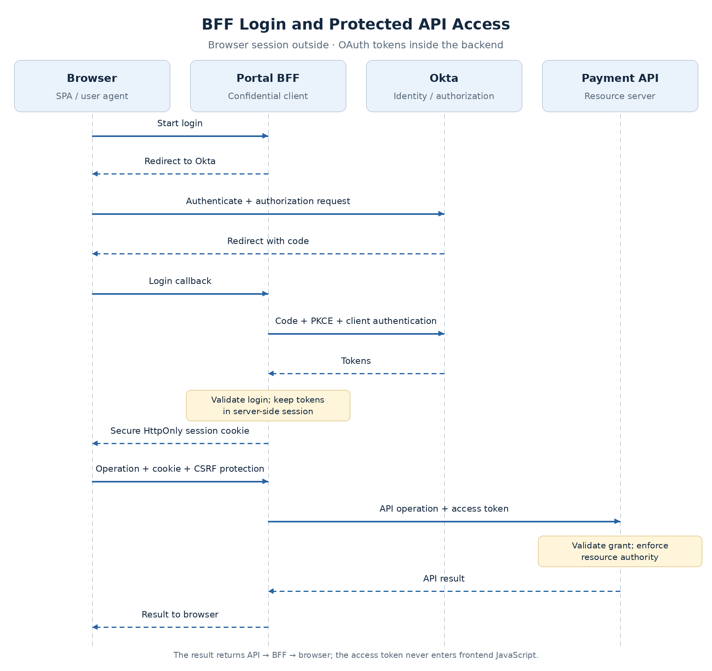

# Browser Token and Session Architecture

Where a browser application keeps its credentials affects what an attacker can steal and which services must remain available. Direct SPA access puts OAuth tokens in the browser. Moving them into a backend reduces that exposure but adds session and proxy responsibilities.

The claims application's [starting model](content.md#the-initial-request-flow) is direct SPA access. Payment approval warrants comparing it with backend-based alternatives. The [scope and business-authority contract](scopes-and-api-access.md) remains the same in each design.

## Compare the browser architectures

| Approach | OAuth client | Browser credential and API path | Trade-off |
| --- | --- | --- | --- |
| SPA + PKCE | Browser public client | Access token; direct API call | No backend proxy, but tokens enter browser code |
| Backend-for-Frontend (BFF) | Backend confidential client | Session cookie; BFF attaches API token | Token isolation, with session and proxy overhead |
| Token-mediating backend | Backend confidential client | Backend supplies access token; browser calls API | Server-side refresh handling, but access token remains exposed |

The frontend can remain a SPA in all three. These architectures are described in [RFC 10017](https://www.rfc-editor.org/rfc/rfc10017.html).

### Direct SPA + PKCE

The SPA obtains tokens and calls the API. It cannot protect a client secret. Avoiding a proxy simplifies the request path, but frontend code and dependencies execute in the environment that uses the tokens.

**PKCE protects the code exchange, not tokens after issuance.** Cross-site scripting (XSS) can let malicious code obtain tokens or act through the application. Memory storage limits persistence; it does not make a compromised runtime safe. See [RFC 9700](https://www.rfc-editor.org/rfc/rfc9700.html) for code-flow security requirements.

### Backend-for-Frontend

The BFF retains OAuth tokens and associates them with a browser session. It forwards allowed API calls with the correct access token, keeping that token out of frontend JavaScript.

The cost is another service on the request path, shared session handling, and protected backend credentials. **Allowlist upstream routes and destinations.** A caller-selected URL would let the browser misuse the BFF's authenticated requests.

### Token-mediating backend

The backend performs OAuth exchanges and refresh handling but returns access tokens to the browser. It avoids proxying all API traffic while leaving a token exposure path: injected code can request an available token through the user's session.

### Token Handler / OAuth Proxy

A token handler can separate OAuth/session handling from API proxying. In [Curity's design](https://curity.io/resources/learn/the-token-handler-pattern/), an **OAuth Agent** performs OAuth exchanges and issues protected cookies; an **OAuth Proxy** converts that browser credential into an authenticated upstream API request. Usable OAuth tokens stay outside frontend JavaScript.

| Component | Responsibility |
| --- | --- |
| OAuth Agent | Login callback, token acquisition/refresh, protected session cookies |
| OAuth Proxy | Session-cookie validation, CSRF controls, allowed forwarding with API tokens |
| Resource API | Access-token validation and business authorization |

This distributes responsibilities that a BFF can own together. It adds agent/proxy coordination, shared session or encryption-key arrangements, and cookie/origin configuration. State can be retained server-side or carried in protected encrypted cookies; encrypted cookies introduce size, key-rotation, and invalidation trade-offs.

Product labels vary. **A backend returning access tokens to JavaScript is token mediation**, even if it is called a token handler. A proxy that keeps usable tokens outside JavaScript provides a different exposure boundary. The claims baseline keeps the simpler BFF deployment; it does not require both designs.

[Phantom Token Architecture](phantom-token-architecture.md) is a separate decision about the token representation accepted at the API gateway.

## The proposed BFF flow

The claims design selects BFF to reduce browser exposure of payment API credentials. Serve the SPA and BFF under the same public origin.

The BFF uses authorization code + PKCE and authenticates itself to Okta. Bind the login response to its initiating browser session, verify the callback and ID token, and consume the login transaction once.

**Backend client authentication does not make this a client-credentials grant.** The access token still represents user-delegated access. The Payment API enforces that grant and the subject's business rights.

## Protect the browser session

The cookie carries an opaque identifier; the BFF resolves it to server-side session and token state. The cookie is now a credential worth protecting.

- **Transport and scope:** HTTPS, `Secure`, `HttpOnly`, and a host-only cookie where appropriate.
- **Lifecycle:** rotate the session ID after authentication; enforce idle and absolute expiry.
- **Storage:** restrict session-store access and protect stored credentials; exclude them from logs.
- **State changes:** apply CSRF protection and origin validation; do not mutate business state with GET.

Cookie-authenticated operations need **cross-site request forgery (CSRF)** controls because browsers attach cookies automatically. Select `SameSite` to support the login callback; different subdomains can be same-site while having different origins. Same-origin hosting simplifies integration but does not replace CSRF controls.

**HttpOnly prevents JavaScript from reading the cookie; it does not prevent injected code from invoking the BFF.** Output encoding, browser content controls, and dependency hygiene remain necessary. See [OWASP sessions](https://cheatsheetseries.owasp.org/cheatsheets/Session_Management_Cheat_Sheet.html) and [CSRF guidance](https://cheatsheetseries.owasp.org/cheatsheets/Cross-Site_Request_Forgery_Prevention_Cheat_Sheet.html).

## Scale sessions and refresh safely

Size BFF capacity for concurrent calls, connection pools, payloads, and upstream timeouts. A shared session store allows instance replacement but becomes a shared dependency. Instance-local sessions instead depend on routing affinity and instance survival.

**Coordinate refresh per session across instances**, then save rotated credentials atomically. Otherwise concurrent calls can overwrite new state or reuse an invalidated refresh token. Refresh does not expand the grant; additional scopes require authorization.

| Failure | Response |
| --- | --- |
| BFF instance lost | Another instance needs valid shared state; otherwise session continuity is lost |
| Session store unavailable | Return an availability error; do not assume a session is valid |
| Refresh temporarily fails | Bound retries; distinguish outage from invalid grant; do not forward expired tokens |
| Approval response times out | Treat the business outcome as uncertain; use the API's reconciliation/idempotency contract |

**Portal session, OAuth token, and Okta SSO session have separate lifecycles.** A session may permit refresh after token expiry. Portal logout does not automatically end SSO or revoke every token; define those actions explicitly. [Token revocation](token-validation-revocation.md#revocation-expiration-and-logout) explains the issuer-status boundary.

## Observe the browser/backend boundary

Measure BFF latency, session-store errors, active sessions, and refresh outcomes. Correlation IDs connect browser-facing requests to downstream results without recording credentials.

Distinguish failed login, expired session, API denial, and dependency failure. A failed login differs from a timeout after payment submission: the latter may have changed business state. Detailed response and retry behavior belongs to the [API enforcement contract](gateway-api-enforcement.md#rejections-and-uncertain-outcomes).

## Proposed decision

Use **BFF with server-held tokens, a protected session, and explicit proxy routes** for the employee portal. Token isolation justifies the added backend for sensitive payment operations.

Prefer direct SPA access when its exposure meets requirements and backend operation is undesirable. Consider token mediation when direct API traffic is necessary and browser access-token exposure is acceptable.

Next: [Gateway and API Enforcement Boundaries](gateway-api-enforcement.md). The applied design and ADRs are in the [claims deep dive](../deep-dives/security/claims-employee-access.md); implementation evidence is pending.
