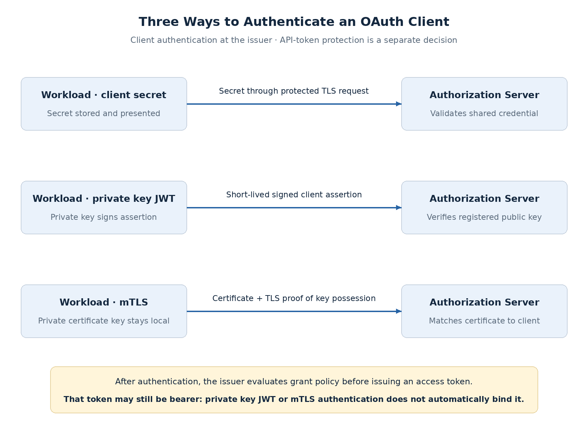

# Client Secrets, Private Key JWT, and mTLS

A workload must prove its client identity before the authorization server issues an access token. The authentication method determines which credential is exposed, how rotation works, and which failures can interrupt token acquisition.

The [Client Credentials grant](client-credentials-machine-identity.md) defines the access flow. **Client authentication is a separate choice.** The same methods can authenticate a confidential client in other flows, including a BFF's authorization code exchange.

## Compare the methods

| Method | Evidence presented to the issuer | What stays with the workload | Main dependency |
| --- | --- | --- | --- |
| Client secret | Shared credential, usually through HTTP Basic authentication | Secret is stored locally and presented to issuer | Secret distribution and rotation |
| `private_key_jwt` | Short-lived signed client assertion | Private signing key; only assertion is sent | Key protection, public-key registration, assertion validation |
| mTLS | Client certificate and proof of key possession during TLS | Private certificate key | Certificate lifecycle and trusted TLS path |

**All three require TLS and controlled credential access.** Moving to asymmetric authentication reduces shared-secret exposure; it does not eliminate credential compromise or lifecycle responsibilities.

## Client secrets: simple integration, shared credential risk

The workload obtains a client ID and secret from the authorization server. The secret authenticates the client; the ID is an identifier, not a secret.

HTTP Basic encoding does not encrypt the credential. TLS protects transmission, while secret storage and redaction protect it inside the workload and its tooling. Use managed secret delivery rather than source code, images, or logs.

A stolen secret can be used to request tokens until it is disabled. Rotation must update the issuer and every affected deployment. Overlapping credentials simplify rollout when the provider supports them; otherwise plan the cutover and recovery explicitly.

**A secret is a reasonable integration baseline when key or certificate operations are unavailable.** Its simplicity comes with a credential that is repeatedly presented to the issuer and can be copied from runtime configuration.

## Private key JWT: authenticate with a signed assertion

The workload registers its public key with the authorization server and signs a short-lived JWT assertion with the private key. The server verifies that assertion before issuing the access token.

**The client assertion and access token are different JWTs:** the workload signs the assertion to authenticate itself; the authorization server issues the API credential.

| Assertion field | Validation purpose |
| --- | --- |
| `iss` / `sub` | Identify the asserting client according to its configured profile |
| `aud` | Bind the assertion to an issuer-accepted audience; exact value is provider-specific |
| `exp` | Limit how long the assertion is usable |
| `jti`, where used | Support replay detection for that assertion |

For client authentication, `sub` identifies the client ID. Typical `private_key_jwt` profiles also use that client ID as `iss`. Validate the provider's audience requirements rather than assuming the API audience belongs in the assertion.

Use a fresh, short-lived assertion for token requests and define replay handling. A signature alone does not make a captured assertion single-use. Clock synchronization and the issuer's replay policy matter. [RFC 7523](https://www.rfc-editor.org/rfc/rfc7523.html) defines the assertion profile; replay enforcement is not automatically provided by adding a `jti`.

Private-key protection is the central operational concern. A compromised process may be able to sign even when it cannot export the key. Managed or hardware-backed signing can reduce extraction risk but adds signer availability, permissions, and latency considerations.

## mTLS: authenticate at the TLS boundary

With mutual TLS, the client presents a certificate and proves possession of its private key during the handshake. The authorization server maps that certificate identity to the registered OAuth client.

A valid certificate chain alone does not authorize any client ID. The certificate must satisfy the configured client identity match. RFC 8705 defines both PKI-based and registered self-signed certificate authentication methods.

**The TLS termination point is part of the trust design.** If a proxy terminates client TLS, the issuer needs authenticated, integrity-protected certificate context from that proxy. Strip untrusted certificate headers; do not accept a browser-supplied identity header as handshake evidence.

mTLS fits environments with established certificate automation and partner trust arrangements. It adds certificate expiry, trust configuration, proxy behavior, and connection troubleshooting. See [RFC 8705](https://www.rfc-editor.org/rfc/rfc8705.html).

## Client authentication does not settle token replay

| Control | Establishes |
| --- | --- |
| Secret, signed assertion, or mTLS at token endpoint | Client identity when obtaining a token |
| Bearer access token | API access based on possession of the token |
| Sender-constrained access token | API access also requires proof using the bound key/certificate |

**Neither private key JWT nor mTLS client authentication automatically makes every access token sender-constrained.** Certificate-bound tokens require issuer binding and resource-server enforcement, including at any TLS termination boundary. They are a separate decision, examined in the sender-constraints topic.

Similarly, rotating an authentication key or secret does not necessarily invalidate tokens already issued. Apply the [token-status and revocation policy](token-validation-revocation.md) separately.

## Rotation and failure behavior

For planned asymmetric rotation: register the new public key or certificate, test it, roll out workloads, verify adoption, then retire the old credential after the defined overlap. Distinguish client authentication keys from the issuer's JWT signing keys; they protect different statements.

| Failure | Response |
| --- | --- |
| Secret/key configuration mismatch | Diagnose registration and rollout; do not retry indefinitely |
| Assertion expired, wrong audience, or replayed | Correct assertion generation/clock/profile; reject unsafe reuse |
| Signer unavailable | Cached access tokens may remain usable under API policy; otherwise defer or fail work |
| Certificate expired or identity mismatch | Correct lifecycle/trust configuration; no plaintext or weaker fallback |
| Mixed old/new deployments during rotation | Use controlled overlap where supported and observe which credential remains in use |

Track token-acquisition failures, rotation adoption, signing latency, and certificate expiry. Audit credential changes and client identity; never log secrets, private keys, assertions, or tokens. Shared signing or credential services can become availability dependencies and burst bottlenecks during renewal.

## Decision guidance

[RFC 9700](https://www.rfc-editor.org/rfc/rfc9700.html) recommends asymmetric authentication where supported. For the claims workloads:

- **Prefer private key JWT** when the issuer supports it and protected signing/rotation can be operated reliably.
- **Choose mTLS** when certificate operations and the issuer-facing TLS path are already controlled, or a partner requirement calls for it.
- **Use secrets as a scoped baseline** when asymmetric support or operations are unavailable, with explicit storage and rotation controls.

The [proposed machine-authentication ADR](../deep-dives/security/claims-employee-access-adrs.md#adr-003-machine-to-machine-client-authentication) records private key JWT as the reference preference, pending provider and operational validation. It does not change the employee BFF's authentication automatically.

Next: downstream delegation and token exchange—when a service should use its own identity, relay user access, or obtain a more narrowly targeted token.
