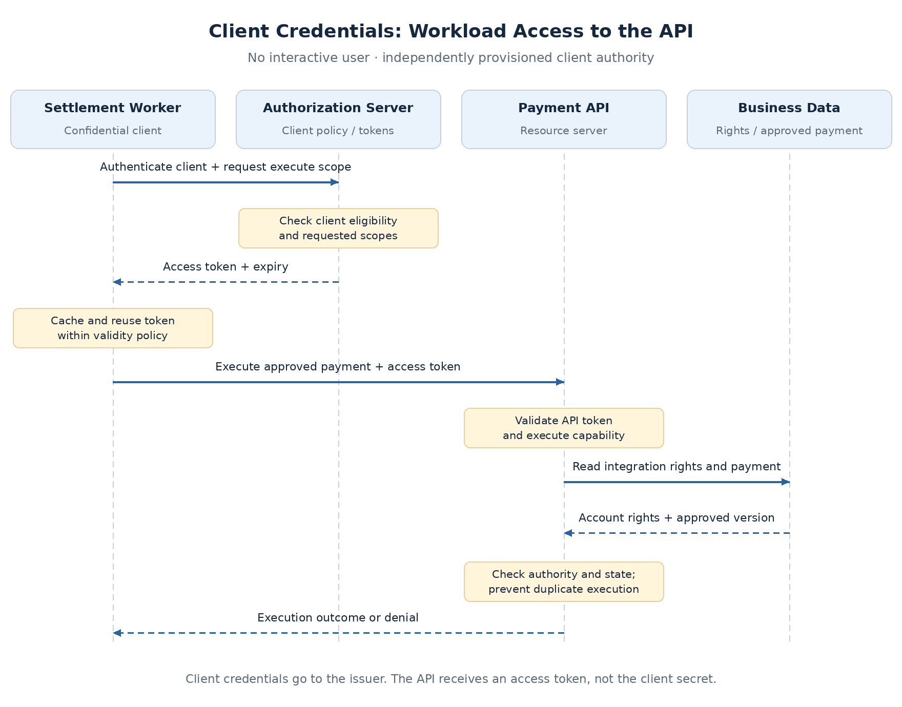

# Client Credentials and Machine Identity

A settlement worker must process approved payments when no employee is signed in. A partner backend may submit requests automatically. Both need an identity and a bounded set of API permissions, without borrowing an employee's session or credentials.

The **Client Credentials grant** allows a confidential client to obtain an access token using its own authentication. The API evaluates the workload's authority rather than an interactive user's authority. The enterprise must provision that authority explicitly; successful client authentication alone does not permit every operation.

## When the caller acts as itself

| Flow | Represented authority | Claims-platform example |
| --- | --- | --- |
| Authorization Code + PKCE | User-delegated access through a client | Employee approves a payment through the portal BFF |
| Client Credentials | Access assigned to the client/workload | Settlement worker executes an approved payment |

A server-side caller does not automatically require Client Credentials. The BFF is a backend but still uses delegated user access. A service continuing a user's request may also need to preserve that authority through an appropriate delegation design.

**Choose the flow according to whose authority is required, not whether the caller is a server.** A machine token cannot stand in for proof that a particular employee authorized an action.

## The token request and API flow

Client Credentials is defined for **confidential clients** in [RFC 6749](https://www.rfc-editor.org/rfc/rfc6749.html#section-4.4). A browser SPA cannot protect the credential needed for this flow.



1. **Authenticate the client:** the workload calls the token endpoint with its configured authentication and requested scopes.
2. **Evaluate issuance policy:** the authorization server checks the client's eligibility and issues an access token.
3. **Call the API:** the workload presents that token; the API validates it and checks workload permissions against the resource.

There is **no employee login, browser redirect, authorization code, or PKCE exchange** in this grant. It does not produce an OIDC ID token. RFC 6749 says a refresh token should not be included; the normal renewal path is another authenticated token request.

An illustrative request using HTTP Basic client authentication is:

```http
POST /token
Authorization: Basic <encoded-client-credentials>
Content-Type: application/x-www-form-urlencoded

grant_type=client_credentials&scope=payment:execute
```

This is one authentication option, not a requirement to use shared secrets. **Basic encoding is not encryption**; protect the request with TLS. Send the resulting access token to the API, not the client secret or private key.

## Give each integration its own authority

Use separate logical client identities for distinct callers and environments. Share an identity across replicas only when they perform the same responsibility under the same authority; use instance-level telemetry when attribution requires it.

| Caller | Candidate scopes | Application-owned restrictions |
| --- | --- | --- |
| Partner backend | `payment:create`, `payment:read` | Contracted merchants and permitted records; no approval or execution |
| Settlement worker | `payment:execute` | Approved payments on assigned accounts; no beneficiary or amount changes |
| Reconciliation service | `payment:read` | Assigned reconciliation accounts and fields; no mutation |

**A shared all-purpose client destroys these boundaries.** Separate identities support different grants, credential rotation, revocation, rate limits, and audit attribution.

In Okta, register the service client and target its custom-server policy by client ID. Client Credentials rules use **No user**; employee-group conditions do not establish machine eligibility. Request custom API scopes, not `openid` or user-profile scopes. Exact provisioning differs by provider; see [Okta's Client Credentials guide](https://developer.okta.com/docs/guides/implement-grant-type/clientcreds/main/).

## Validate workload and resource authority

The API uses the existing [validation contract](token-validation-revocation.md), then maps the validated issuer and provider-defined client identity to an internal integration record. Claims such as `sub`, `client_id`, or Okta's `cid` vary by token profile. **Do not assume every `sub` is an employee ID**, or trust a caller-supplied client header.

Scopes establish the granted capability. Current integration entitlements establish permitted merchants or accounts. Custom machine claims can carry stable metadata, but resource lists and frequently changing rights have the same freshness trade-off described in [Scopes, Groups, and API Access Decisions](scopes-and-api-access.md).

For settlement, the API must also verify:

- **Approval exists** for the transaction being executed.
- **Amount, beneficiary, and account match** the approved version.
- **Payment state permits execution**, and replay cannot execute it twice.

Record the approving employee and executing workload separately. The employee's prior approval is persisted business evidence; the worker does not need to reuse that employee's access token.

## Separate grant type from client authentication

| Method | How the workload authenticates | Main operational concern |
| --- | --- | --- |
| Client secret | Presents a shared credential to the authorization server | Secret distribution, storage, rotation, and exposure |
| `private_key_jwt` | Signs a short-lived assertion verified with its registered public key | Private-key protection, assertion replay controls, and key rotation |
| mTLS | Proves possession of a client-certificate key during TLS | Certificate lifecycle and correct TLS termination |

[RFC 9700](https://www.rfc-editor.org/rfc/rfc9700.html) recommends asymmetric client authentication where supported. These methods can also authenticate other confidential-client flows; they are not exclusive to Client Credentials.

**`private_key_jwt` and mTLS are different mechanisms.** Authenticating with a key does not automatically bind the issued access token to that key. A bearer token can still be replayed if stolen unless sender constraints are separately implemented and enforced.

This page establishes the choices. The next topic compares their lifecycle and failure behavior before selecting the machine-authentication standard in ADR-003.

## Cache tokens without creating an issuer bottleneck

Acquire a token for the required audience and scope set, then reuse it until shortly before expiry. Use the trusted expiry metadata returned by the issuer; avoid fetching a token for every business request.

- **Partition caches** by client identity, recipient, and grant configuration.
- **Coordinate acquisition** so concurrent requests do not all renew the same token.
- **Stagger renewal** across instances to avoid synchronized bursts.
- **Bound retries** for transient failures; investigate invalid credentials or denied scopes rather than repeatedly retrying them.

Cache scope sets deliberately: an execution token should not accidentally become the default token for a read-only integration.

## Failures and operational evidence

| Condition | Expected behavior |
| --- | --- |
| Issuer unavailable, cached token still acceptable | Calls may continue under API validation and authorization policy |
| No usable token can be obtained | Defer or fail work according to its contract; never borrow another identity |
| Credential rejected after rotation | Diagnose configuration; do not loop indefinitely |
| Valid token, unauthorized account or merchant | API denies operation |
| API timeout after submission | Reconcile status or use a defined idempotency contract before retrying |

Revoking a client credential blocks future issuance once effective; it does **not automatically invalidate every cached access token**. Access-token revocation and its enforcement are separate, provider-specific mechanisms. Decide the acceptable removal delay for each workload operation; do not inherit the employee-approval introspection policy without evaluating it.

Measure token acquisition latency/errors, cache renewal, rate-limit responses, API denials, and execution outcomes. Audit the workload, resource/version, operation, result, and correlation ID. Exclude secrets, assertions, and tokens from logs.

## Architecture guidance

Use Client Credentials for **independently authorized workload or partner access**. Preserve user delegation when an operation depends on the user's authority. Keep scope grants, current integration entitlements, and transaction-state checks explicit.

The claims platform will add distinct partner, settlement, and reconciliation identities when implementation resumes. The remaining backend stack does not change; provider-specific configuration and validation belong in the lab.

## Related concepts

- [Identity and Access Foundations](content.md)
- [Gateway and API Enforcement Boundaries](gateway-api-enforcement.md)
- [JWT Validation, Introspection, and Revocation](token-validation-revocation.md)
- [RFC 8705: mTLS authentication and certificate-bound tokens](https://www.rfc-editor.org/rfc/rfc8705.html)
