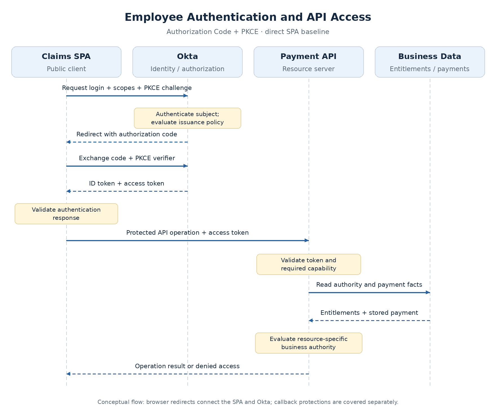

# Identity and Access Foundations

Managing login independently in every application spreads credential handling, authentication policy, and account lifecycle across teams. A central identity platform provides a common way to establish identity and issue access credentials.

The API still owns facts that a login service may not hold: which account funds a payment, who initiated it, and whether its state permits approval. **Central identity and application authorization work together, with different responsibilities.**

## The components involved

The starting example has a claims SPA, a Payment API, and Okta. Okta performs two logical roles: identity provider and authorization server.

| Component or role | Responsibility | Example |
| --- | --- | --- |
| Identity provider (IdP) | Authenticates users; can use federation and additional factors | Okta establishes employee identity |
| Authorization server | Evaluates access requests and issues tokens | Okta custom server grants Payment API access |
| Client application | Requests tokens and uses granted access | Claims SPA in the direct-browser model |
| Resource server | Accepts API access credentials and protects resources | Payment API |
| Subject / principal | Identity represented in the request or credential | Employee approving a payment; later, a workload |
| Resource owner | Party capable of authorizing resource access in the OAuth model | Often the end user in delegated flows; enterprise policy also governs access |
| Entitlement store | Assigned business rights and constraints | Account access and approval limits |

One product can perform several roles. Authentication establishes identity; token issuance grants access; the resource server enforces access to its operations and data.

**Protecting an API does not automatically require registering it as an OAuth client.** In this design, its audience and scopes are configured at the custom authorization server, and the API trusts that issuer. A separate client registration may be needed for capabilities such as authenticated introspection.

## OAuth 2.0 and OpenID Connect

**OAuth 2.0** provides the framework for granting a client access to a protected API. **OpenID Connect (OIDC)** adds authentication: an ID token allows the client to establish who authenticated.

One authorization code flow can return both token types. Their recipients and purposes differ:

| Token | Intended recipient | Purpose |
| --- | --- | --- |
| ID token | Registered client | Describes user authentication and identity |
| Access token | Protected API | Represents granted API access |
| Refresh token, when enabled | Authorization server | Obtains replacement access tokens under the existing grant |

The ID token's audience identifies the client. The access token's audience identifies its API or resource boundary. **An ID token is not the Payment API's access credential**, even if it contains the same user or group information.

A signature proves who signed the claims; it does not change their intended recipient or purpose. Accepting an ID token at the API can bypass the API grant and audience boundary.

Access tokens are not universally JWTs. This reference design uses JWT access tokens from an Okta custom authorization server. Protocol responsibilities are defined in [OIDC Core](https://openid.net/specs/openid-connect-core-1_0.html) and [OAuth 2.0](https://www.rfc-editor.org/rfc/rfc6749.html).

## The initial request flow

The direct SPA model uses **Authorization Code + PKCE**. Browser code cannot protect a client secret, so the SPA is a **public client**. Its client ID identifies the application but is not a secret or proof of client authenticity.

PKCE binds the authorization code exchange to the initiating transaction. It does not turn the SPA into a confidential client.



The flow has three stages:

1. **Authenticate and request access:** the client redirects to Okta with its scope request and PKCE challenge.
2. **Obtain credentials:** the client exchanges the returned code using its verifier and validates the authentication response.
3. **Call the API:** the access token accompanies the operation; the API validates it and evaluates business authority.

A backend client can also use authorization code. It can protect client credentials, authenticate to the authorization server, and use PKCE. **Client type, grant type, and client authentication are separate decisions.** [RFC 9700](https://www.rfc-editor.org/rfc/rfc9700.html) recommends PKCE for confidential clients as well.

## Authorization vocabulary

| Term | Meaning | Example |
| --- | --- | --- |
| Group | Membership used for assignment or policy | Payment Approvers |
| Role | Business responsibility associated with permissions | Claims approver |
| Permission | Allowed action, potentially resource-specific | Approve a payment |
| Scope | Named OAuth access capability | `payment:read`, `payment:approve` |
| Entitlement | Assigned right with business constraints | Approve Account East payments up to $25,000 |
| Claim | Token statement | `sub`, `iss`, `aud`, `exp` |
| Custom claim | Application/provider-defined statement | `roles`, `approval_limit` |
| Authority | Access-right term or framework representation | Spring Security's `SCOPE_payment:approve` |
| Policy | Rules producing an access decision | Account access, amount limit, and no self-approval |

A group can establish scope eligibility, and a role can appear in a custom claim. Those relationships require configuration and API interpretation. **Claims describe statements; not every claim is a permission.** Okta's `scp` claim carries granted scopes.

An **authorization grant** supplies the basis for obtaining a token. A **grant type** names the mechanism, such as `authorization_code` or `client_credentials`. “Granted scopes” means approved access, not another grant type. Client credentials is covered later for requests without an interactive user.

## Resource and operation boundaries

```http
POST /payments/PAY-123/approve
Authorization: Bearer <access-token>
```

`POST /payments/{id}/approve` is the **endpoint**; `PAY-123` is the **resource**. Calling it requests an operation on that payment.

The API distinguishes:

- **Granted capability:** does the token permit payment approval?
- **Resource authority:** may this subject approve `PAY-123`, given its account, amount, initiator, and state?

The [scope and authorization topic](scopes-and-api-access.md) develops that distinction and its alternatives. Resource checks must apply to the requested object, consistent with [OWASP authorization guidance](https://cheatsheetseries.owasp.org/cheatsheets/Authorization_Cheat_Sheet.html).

## Responsibility boundary

The identity platform authenticates and issues grants. The client obtains and presents the appropriate credential. The API validates that credential and enforces its business rules.

Next: [Scopes, Groups, and API Access Decisions](scopes-and-api-access.md).
