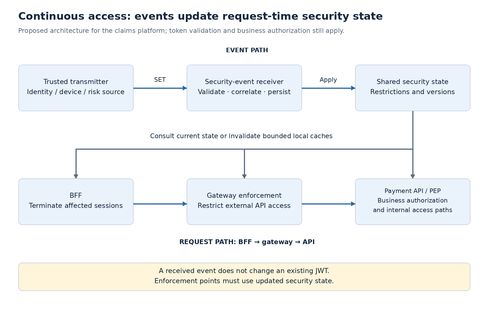
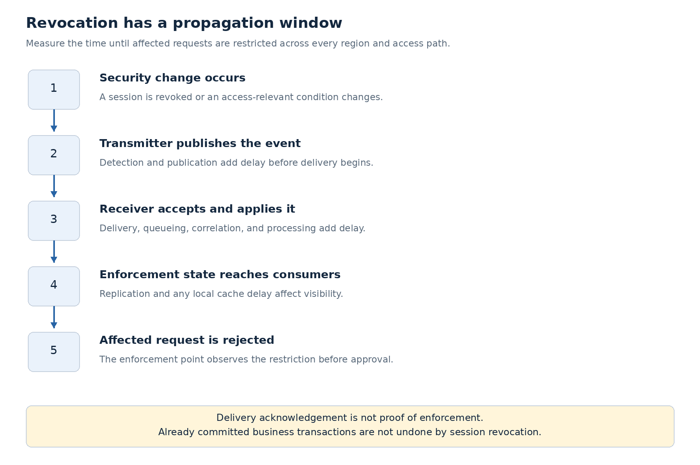

# Continuous Access Evaluation and Shared Signals

Access can become unsafe after a successful login. An employee's session may be revoked, a device may become noncompliant, or a risk assessment may change while the application still holds an unexpired access token.

**Continuous access evaluation brings those changes into subsequent access decisions.** It complements token validation, current entitlements, and step-up authentication; each addresses a different part of the decision.

In the claims platform, a revoked employee session must stop approval requests through the BFF. API access using tokens associated with that session must also be restricted, including paths that bypass the BFF. The design therefore needs both event delivery and enforcement of updated security state.

## Separate the standards and their responsibilities

| Component | Responsibility |
|---|---|
| Shared Signals Framework (SSF) | Establishes event streams between cooperating transmitters and receivers, including configuration, delivery, and verification. |
| Continuous Access Evaluation Profile (CAEP) | Defines access-related event types carried through SSF. |
| Security Event Token (SET), RFC 8417 | Represents a security event in a JWT envelope. A SET is not an API access token. |
| RFC 9493 | Defines structured subject identifiers used to identify who or what an event concerns. |
| RFC 8935 / RFC 8936 | Define HTTP push and poll delivery of SETs. |

CAEP is an OpenID profile, not another OAuth grant type. **RFC 9493 is not the CAEP specification.** The [SSF](https://openid.net/specs/openid-sharedsignals-framework-1_0-final.html) and [CAEP](https://openid.net/specs/openid-caep-1_0-final.html) final specifications provide the framework and event definitions.

## Decide what each event changes

An event reports a fact from a trusted source. The receiver applies local policy to that fact; it does not blindly execute a remote authorization command.

| CAEP event | Meaning | Proposed claims-platform response |
|---|---|---|
| `session-revoked` | The identified session has been revoked. | Invalidate matching BFF sessions and reject API access associated with them. |
| `token-claims-change` | A claim associated with an identified token has changed. | Invalidate affected cached decisions; require current authoritative data or a suitable replacement token. |
| `credential-change` | A credential has changed. | Evaluate the change type and incident policy; do not assume every routine rotation requires disabling the account. |
| `assurance-level-change` | Authentication assurance has changed. | Re-evaluate sensitive operations and require step-up where appropriate. |
| `device-compliance-change` | Device compliance has changed. | Restrict operations requiring compliant devices, using trustworthy session-to-device mapping. |
| `risk-level-change` | The reported risk level has changed. | Apply a configured restriction or challenge policy rather than treating risk as permission. |

Account locking or disabling is also relevant, but do not invent a universal CAEP `account-locked` event. Establish the supported event profile or provider integration for that signal. Business entitlement changes remain the responsibility of the application's entitlement authority.

## Keep event handling separate from request handling

Use a dedicated security-event receiver rather than making every service implement external SSF delivery. The receiver validates events, resolves their targets, and durably updates shared security state. BFFs, gateways, and service policy enforcement points consume that state.

This adds two cooperating paths:

- **Event path:** receive a trusted change, identify affected sessions or subjects, and propagate the resulting restriction.
- **Request path:** validate the access token and evaluate current restrictions alongside the operation's scope and business authorization.

A gateway can enforce a shared session restriction, but services must cover internal access paths too. Decide whether services consult the state directly or rely on a trusted enforcement contract. Merely forwarding the original token does not carry proof that an event-based check occurred.

**Deleting the BFF session alone is insufficient.** It stops future browser requests through that session, but a previously obtained bearer token may remain usable elsewhere unless the receiving API consults updated state or token status.

## Match the event to the correct identity

Subject correlation is a security boundary. Build and retain a mapping between external identifiers and local sessions during login and token handling.

| Event target | Required mapping |
|---|---|
| User | Issuer-qualified subject and tenant to the appropriate local identity. |
| Session | The transmitter's session identifier to BFF sessions and API credentials covered by that session. |
| Token | The supported token identifier to the affected local token or decision context. |
| Device | Trusted device identity to sessions established from that device. |

The event issuer identifies the transmitter; an issuer inside a subject identifier identifies the subject's identity authority. Do not assume they are interchangeable. Pairwise subject identifiers can differ across clients, so matching plain `sub` values or email addresses is insufficient without an agreed correlation contract.

Use [RFC 9493](https://www.rfc-editor.org/rfc/rfc9493.html) subject formats supported by both parties. Do not assume every access token contains an identity-provider session identifier. If session-level correlation is unavailable, document the supported enforcement granularity; a deliberate user-wide restriction is broader than revoking one session.

## Validate, persist, then apply

For this architecture, require integrity-protected SETs and authenticated delivery. Validate expected issuer, receiver audience, approved algorithms and keys, event structure, supported event type, and subject format. Apply timing rules appropriate to the agreed event profile; do not reuse an API access-token validator without adapting its token-type and claim expectations.

Separate validators prevent a SET from being accepted as an API credential, or an ordinary JWT from being accepted as a security event. [RFC 8417](https://www.rfc-editor.org/rfc/rfc8417.html) explains this token-confusion boundary.

Then:

1. **Durably accept:** record validated events before acknowledging successful acceptance; use a durable inbox or queue for later processing.
2. **Resolve and deduplicate:** use the trusted issuer and event `jti`; quarantine unsupported or unmappable events rather than silently claiming enforcement.
3. **Apply idempotently:** update restrictions and invalidate affected caches across instances and regions.
4. **Record enforcement:** track completion separately from delivery acknowledgement. Retry failed application without undoing restrictions already applied.

Events may arrive late, out of order, or more than once. Define ordering and recovery using source-supported versions or event semantics; token issuance time is not a universal state version. A late low-risk event must not clear a newer incident restriction. Restoring access requires an explicit authoritative recovery decision.

## Measure the revocation window

**Event delivery is asynchronous; it does not guarantee instant termination.** The exposure window includes detection, publication, delivery, processing, state propagation, and any enforcement-cache delay. If an event is lost, recovery behavior determines how long the restriction can remain unknown.

For an already committed payment, revocation does not undo the business transaction. For an in-flight approval, define where the last security check occurs relative to commit. High-risk operations may need a transactional check or coordinated security-state version; a check performed earlier cannot eliminate every race.

| Mechanism | What it contributes | Remaining limitation |
|---|---|---|
| Local JWT validation | Fast integrity, issuer, audience, and expiry checks | Cannot observe a later security event by itself. |
| Short token lifetime | Bounds use of an old token when renewal is prevented | Leaves a window and does not replace current business authorization. |
| Introspection | Obtains issuer-reported current token status | Its meaning and freshness depend on issuer behavior and caches. |
| Event-fed security state | Enables affected requests to be restricted before token expiry | Requires delivery, correlation, propagation, and request-time enforcement. |

Choose a measurable time-to-enforcement target for sensitive operations. Include every region and access path in that target rather than measuring only receiver acknowledgement.

## Plan for delivery and state failures

Push delivery offers prompt notification when the receiver is reachable; polling supports receivers that retrieve events. Both require operational handling of backlog and failures. See [RFC 8935](https://www.rfc-editor.org/rfc/rfc8935.html) and [RFC 8936](https://www.rfc-editor.org/rfc/rfc8936.html).

For the claims platform:

- **Known revocation:** keep the restriction even if the stream later fails. A delivery outage must not restore access.
- **Stale security state:** deny sensitive approvals when the agreed freshness bound cannot be established. Any continued read access needs an explicit, bounded policy.
- **Receiver restart or missing events:** replay retained events and reconcile with an authoritative source where supported. Stream verification tests connectivity; it does not prove that no business event was missed.
- **State-store outage:** fail sensitive operations closed and return temporary unavailability where appropriate. Do not fabricate a permission denial or silently fall back to token-only approval.

Monitor stream health, oldest unprocessed event, duplicate rate, unmapped subjects, application failures, regional propagation, and end-to-end enforcement latency. A quiet stream alone proves neither health nor failure. Keep identifiers and audit records minimal; avoid logging raw SETs or sensitive incident details by default.

## Proposed adoption boundary

Introduce this pattern when security changes require a faster response than token expiry or periodic checks can provide. It adds a receiver, identity correlation, distributed state, and operational recovery; adopting a standard without these capabilities does not complete the design.

**Proposed design:** a dedicated receiver maintains event-fed restrictions; the BFF terminates affected local sessions; gateway and API enforcement cover the relevant request paths. Current application entitlements remain authoritative for payment permissions.

Confirm provider support for event profiles, delivery methods, identifiers, and reconciliation before committing to an Okta-specific setup. A vendor webhook is not automatically SSF/CAEP compatible.

Keep this concept under Application & API Security and apply it to the [claims employee-access deep dive](../deep-dives/security/claims-employee-access.md). When the enterprise lab resumes, prioritize session revocation, duplicate delivery, a disconnected stream, and API access using an old token.

Related: [Step-Up Authentication](step-up-authentication.md), [Token Validation and Revocation](token-validation-revocation.md), and [Policy Decision and Enforcement](policy-decision-enforcement.md).
