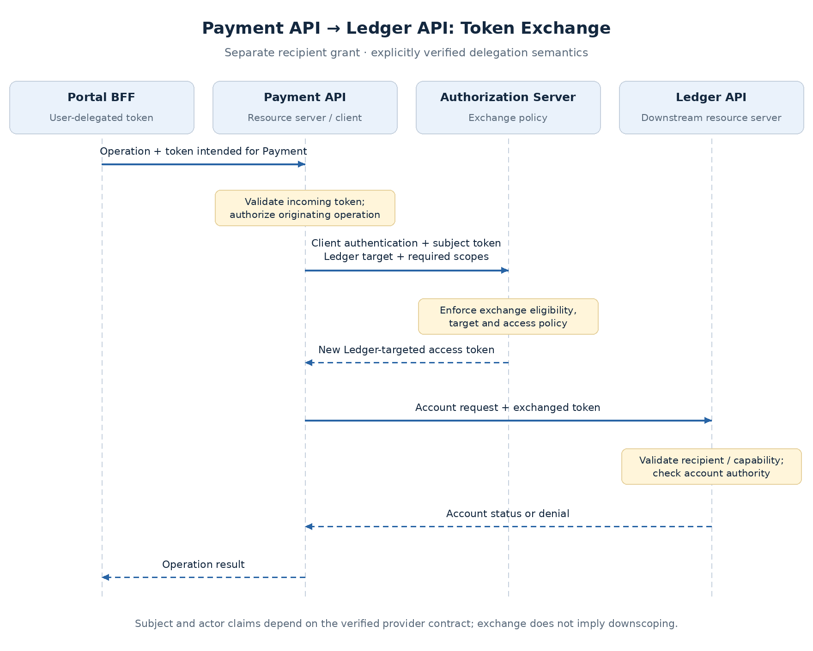

# Downstream Delegation and Token Exchange

A Payment API may need account information from a Ledger API before approving a payment. The incoming token proves access to Payment API, but that does not necessarily make it an acceptable Ledger credential.

The downstream call needs an explicit authority model: preserve the user's granted access, use the service's independently assigned rights, or obtain a token targeted to Ledger. That choice affects privilege, audit attribution, and dependencies on the authorization server.

## Decide whose authority Ledger needs

| Situation | Appropriate authority |
| --- | --- |
| Payment API reads an account as part of an employee operation | User context plus the calling service's permitted delegation |
| Settlement worker posts an already-approved transaction | Independently assigned workload authority and persisted approval evidence |
| Internal request requires no user-specific rights | Service authority, constrained to its task |

**An internal network hop does not erase the authorization boundary.** Ledger must verify its accepted credential and enforce account/resource rights. A service's broad access must not silently replace the user's narrower authority.

The [Client Credentials topic](client-credentials-machine-identity.md) covers independent workload access. This page addresses synchronous downstream calls that may need user context.

## Compare the three approaches

| Approach | Credential sent to Ledger | Benefit | Constraint |
| --- | --- | --- | --- |
| Token relay | Original user access token | No extra token acquisition | Ledger must be an intended audience, with suitable permissions |
| Client Credentials | Payment service's machine token | Independent service authority | Does not establish the user's delegated authority |
| Token exchange | Newly issued Ledger-targeted token | Explicit target and permitted delegation | Issuer policy, provider support, and another dependency |

### Relay only when the token contract permits it

If the incoming token has only `aud = Payment API`, Ledger must not accept it. Token relay is viable when the issuer intentionally grants access to both services and each enforces its own permissions.

A multi-audience token can simplify calls but expands the token's acceptance surface and exposes it to more components. Adding Ledger to every token merely to make forwarding work weakens the original recipient boundary.

### Use machine access for a machine-authorized task

A Client Credentials token allows Payment service to act under its own assigned rights. It does not prove that an employee may read a particular ledger account.

Forwarding an employee ID beside the machine token does not create delegation by itself. A design using workload authentication plus user context must define how that context is authenticated, bound to the request, and checked downstream.

### Exchange when downstream access needs a separate grant

[RFC 8693](https://www.rfc-editor.org/rfc/rfc8693.html) defines token exchange: a client presents a security token and requests another token under issuer policy. For this design, Payment API becomes a confidential OAuth client for the exchange and requests Ledger access on behalf of the incoming subject.

**Exchange does not automatically reduce privileges or preserve actor identity.** The issuer must enforce the allowed target, capabilities, and delegation semantics.

## The exchange flow

1. **Validate the incoming request:** Payment API accepts the user token intended for it and authorizes the requested operation.
2. **Authenticate the exchanging service:** Payment API presents its client authentication and the incoming subject token to the issuer.
3. **Request a downstream grant:** ask for the Ledger target and required capability, such as `ledger:account-status`.
4. **Enforce exchange policy:** the issuer validates the input, client eligibility, target, and permitted capabilities.
5. **Call Ledger:** use the exchanged token; Ledger independently validates and authorizes the resource request.

The original token is not edited. The result is a separate credential with its own audience, lifetime, and permissions.

| Exchange input | Purpose |
| --- | --- |
| `grant_type` | Select the token-exchange grant |
| `subject_token` and its type | Present the identity/access being exchanged |
| Client authentication | Establish which service requests the exchange |
| `audience` / `resource`, as supported | Identify the intended downstream recipient |
| `scope` | Request downstream capabilities |
| `actor_token`, when applicable and supported | Supply an explicit actor for delegation semantics |

Exact target identifiers and supported parameters differ by provider. Scope names may differ between APIs; restricting privilege requires an explicit policy mapping, not just comparing scope strings.

## Preserve subject and actor deliberately

The **subject** is the represented user. The **actor** is the service performing the downstream operation. Ledger may need both to answer who requested access and which service exercised it.

RFC 8693 distinguishes delegation from impersonation. A result retaining only the subject can hide the acting service. Delegation can express an actor through an `act` claim, but the provider's supported flow determines how it is populated.

**Client authentication, an `actor_token`, and the resulting `act` claim are not interchangeable.** Verify the actual issued claims and their meaning. Prior actors in a chain are audit context, not automatic grants of authority.

Record subject, verified calling actor/client, resource, operation, and correlation ID. Do not substitute a user-supplied identity header for trusted token context.

## Prevent the confused-deputy failure

A caller may try to exploit Payment API's legitimate Ledger access by requesting an unrelated account. Payment API must resolve the account from the authorized payment rather than blindly forward an arbitrary identifier.

Enforce the boundary at both ends:

- **Issuer:** restrict which clients can exchange, which input issuers/tokens are trusted, and which targets and capabilities may be issued.
- **Payment API:** authorize the originating operation and select its permitted target and resource.
- **Ledger API:** require its audience and capability, then evaluate the represented authority over that account.

A correctly exchanged token is not permission for every Ledger record. Downstream account checks remain essential.

## Cache and failure behavior

Exchange can add latency and issuer load to the call path. If caching is appropriate, bind entries to the exchanging client, subject-token context, target, requested scopes, and relevant actor context. **Never reuse one user's exchanged token for another.** Bound expiry and define the permitted stale-access window.

Do not assume revoking the original token automatically revokes the exchanged token. RFC 8693 does not mandate that linkage. Provider behavior and downstream status/entitlement enforcement must meet the access-removal requirement.

| Failure | Response |
| --- | --- |
| Exchange denied or target unsupported | Fail the delegated operation; diagnose policy/support |
| Issuer unavailable | Use an already valid cached grant only if policy permits; otherwise no downstream action |
| Ledger rejects audience, scope, or authority | Preserve denial; do not retry with a more privileged identity |
| Ledger times out during a required account check | Do not approve on unknown account status |
| Mutation result is uncertain | Reconcile or use a defined idempotency contract before retrying |

Bound exchange retries and concurrent acquisition. Monitor exchange latency, policy denials, cache behavior, and downstream failures separately. Correlate issuer events with API audit records, while excluding tokens and client assertions from logs.

## Proposed direction

For user-dependent account checks, prefer **Ledger-targeted exchange with verified subject/actor semantics**, where the provider supports it. Use Client Credentials for independently authorized settlement work. Relay only where the audience and access model intentionally permit it.

Provider support is not uniform. [Okta's on-behalf-of flow](https://developer.okta.com/docs/guides/set-up-token-exchange/main/) and [Keycloak token exchange](https://www.keycloak.org/securing-apps/token-exchange) have different constraints; validate feature availability, delegation claims, and scope policy before implementation. This is a proposed extension, not a claim that either tenant is already configured.

Next: sender-constrained access tokens—how mTLS certificate binding and DPoP address replay after a token has been issued.

## Related concepts

- [Gateway and API Enforcement Boundaries](gateway-api-enforcement.md)
- [Client Secrets, Private Key JWT, and mTLS](client-authentication-methods.md)
- [JWT Validation, Introspection, and Revocation](token-validation-revocation.md)
