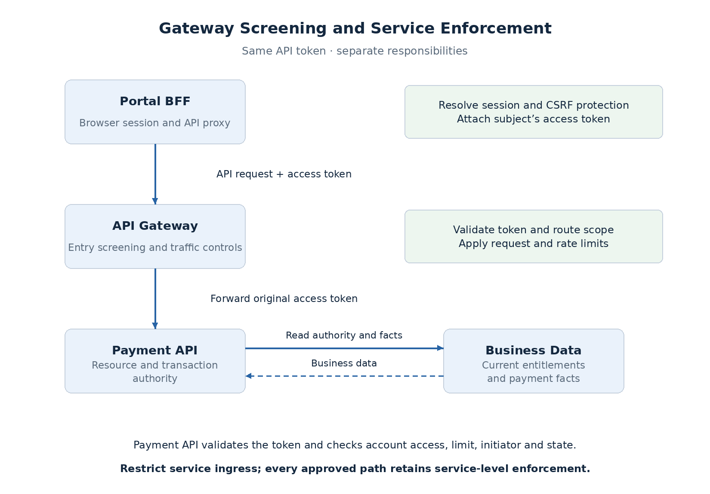
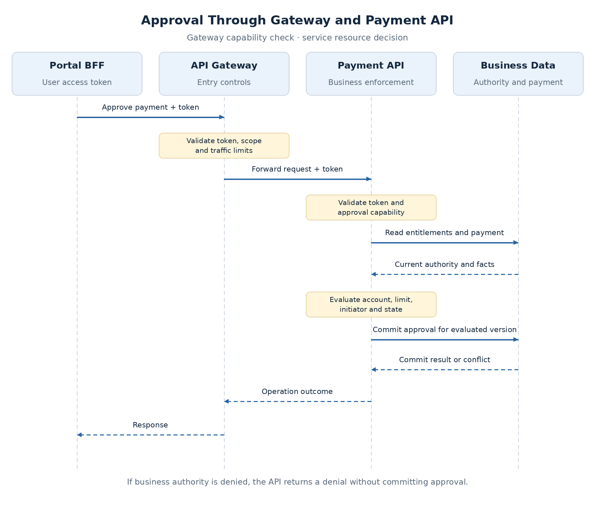

# Gateway and API Enforcement Boundaries

A gateway can reject invalid credentials, restrict routes, and limit traffic before requests reach a service. It usually lacks the current data needed to decide whether a particular payment may be approved.

An approval request can have a valid token and the right scope while exceeding the subject's amount limit. Place each check where its facts are available, and protect alternate ingress so it cannot bypass enforcement.

## Divide the responsibilities

| Component | Owns | Approval example |
| --- | --- | --- |
| BFF | Browser session, CSRF protection, allowed API forwarding | Attach the session's access token |
| Gateway | Credential/scope screening, routing, traffic controls | Reject invalid token or missing `payment:approve` |
| Payment API | Accepted credential, resource authority, transaction state | Enforce account, limit, initiator, and state |

BFF and gateway may share infrastructure; their trust contracts differ. **The API does not automatically trust a BFF session cookie.** It accepts the configured API credential.

## Choose how identity reaches the service

| Design | Benefit | Required trust arrangement |
| --- | --- | --- |
| Gateway validation with forwarded context | Central credential-validation configuration | Authenticate gateway-to-service path, protect context integrity, and exclude untrusted alternate ingress |
| Gateway and service validate original token | Service independently verifies its accepted credential | Consistent issuer, audience, and capability rules |
| Gateway-issued signed assertion | Separate internal identity contract | Trusted issuer, keys, audience, expiry, and protected propagation |

Gateway context can be viable in a controlled architecture. **Unsigned identity headers from any reachable caller are insufficient.** A signed assertion also leaves resource authorization with the service.

The claims design forwards the original Payment API token and validates it at both layers. This avoids adding another issuer before it is needed. See [OWASP microservices guidance](https://cheatsheetseries.owasp.org/cheatsheets/Microservices_Security_Cheat_Sheet.html) for edge and identity-propagation alternatives.

## Follow the approval request

The gateway checks the credential and route capability. The API repeats the checks for its own accepted token, then evaluates current entitlements against the stored payment. Approval commits only against eligible state and the evaluated version.

A token with `payment:approve` can pass the gateway and fail account authorization at the API. **That denial is expected behavior.** Keep the business rules in the owning service; copying approval limits into gateway configuration creates two owners with different data and release cycles.

The API also needs a concurrency strategy for entitlement changes during approval. Conditional payment version protects against transaction edits, not every race with changing permissions.

## Protect every admitted ingress path

- **Restrict connectivity:** admit approved gateways and workloads using appropriate network controls.
- **Enforce identity:** require the accepted credential and business checks on every admitted path.
- **Protect forwarded context:** strip or overwrite caller-supplied `X-User-Id`, `X-Groups`, and similar headers.
- **Review routing:** new methods, aliases, and rewritten paths must not inherit weaker access rules.

Private addressing limits reachability; it does not establish resource authority. A direct diagnostic call with no credential must fail even from an admitted network. A valid internal caller still needs its granted capability and business rights.

In the selected token-forwarding design, derive identity from the token. A header-based alternative must authenticate the source and protect header integrity. Gateway and service must also agree on the operation after normalization and route rewriting.

## Scaling and configuration

Signature checks consume CPU; entitlement queries and transaction coordination have different costs. Measure them separately. Cached issuer keys normally avoid remote key lookup on each request; [token validation](token-validation-revocation.md) owns cache and refresh behavior.

Scale gateway instances with consistent route policies and the intended rate-limit semantics. Limits based only on the BFF's source address cannot distinguish employees. Use trusted subject/client information where suitable; trust forwarded addresses only from controlled sources.

The API's scaling constraints include entitlement-query cost and transaction contention. Optimize those paths without weakening required freshness. Endpoint contracts, gateway rules, and service security configuration need coordinated review during changes.

## Rejections and uncertain outcomes

| Condition | Contract |
| --- | --- |
| Missing, invalid, expired, or inactive API token | `401` with appropriate Bearer challenge |
| Valid token without required scope | `403` |
| Resource outside subject visibility | Consistent `404` policy to limit enumeration |
| Visible resource, denied business action | `403` with a safe reason |
| Payment state/version conflict | Commonly `409`; no stale approval |
| Required security/data dependency unavailable | Availability error, commonly `503`; no decision based on unknown rights |

[RFC 6750](https://www.rfc-editor.org/rfc/rfc6750.html) specifies Bearer credential errors. Visibility and conflict responses are application choices; apply them consistently. Invalid credentials and inability to verify credentials are different outcomes.

**A timeout does not prove the payment operation failed.** If approval committed before the gateway timed out, blind retry may repeat work. Bound upstream timeouts and retries; mutations need an explicit idempotency or status-reconciliation contract.

## Operate the enforcement chain

Record the rejecting layer and safe reason: session, token, scope, business authority, or transaction conflict. Correlation links those events to an audit record containing subject, relevant client, action, resource/version, and outcome.

Monitor gateway throttling, token/scope failures, authorization latency, dependency errors, and conflicts separately. An invalid-token surge and an entitlement-store outage require different investigation. Exclude tokens, cookies, and sensitive entitlement details from logs.

**Route changes are security changes** when they alter reachable operations or required capabilities. Validate default-deny behavior and policy consistency as part of deployment.

## Proposed decision

Use **gateway screening plus independent service enforcement**. Keep resource and transaction rules in the Payment API, restrict ingress, and preserve its checks on every approved path.

Repeated credential verification adds work but reduces reliance on one routing configuration. Consider signed internal assertions later if transformation or internal trust requirements justify them.

Next: [JWT Validation, Introspection, and Revocation](token-validation-revocation.md).
