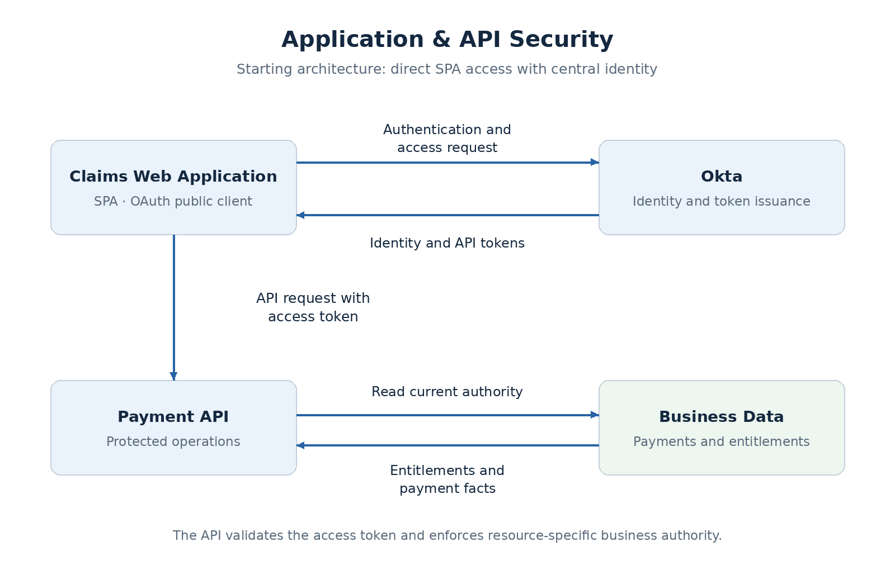

# Application & API Security

A web application needs more than a successful login to protect its APIs. It must establish who is calling, what access the application has been granted, and whether the requested operation is allowed on the specific resource. It also needs to handle sessions, credential exposure, access changes, and failures in the services that enforce those decisions.

**JWT validation is one control within that architecture.** A correctly signed token supplies trusted claims; the API still needs the business facts required to authorize the operation.

This section starts with a web application and backend API using centralized identity. It builds from scope grants and browser sessions to machine identity, downstream delegation, runtime policies, and changing trust after login. Each topic adds a decision to the same architecture.

## The access problem

Consider an employee application that can view, create, and approve payments. Its design needs to answer:

- **Identity:** who authenticated, and through which identity provider?
- **Application access:** which client is acting for the user, and what capabilities were granted?
- **Resource authority:** may that user perform this operation on this payment?
- **Access lifecycle:** what happens after logout, permission removal, or token revocation?
- **Failure behavior:** what happens when a required check cannot be completed?

A central identity platform provides common authentication and token issuance. The application owns the business context: account access, approval limits, payment ownership, and workflow state. The design must assign responsibility for each check rather than treat login as unrestricted access.

## The reference application

The example is a **claims payment system** with a browser-based single-page application (SPA), a Payment API, and Okta as the identity platform.

| Employee responsibility | Business task |
| --- | --- |
| Initiator | Create a payment request |
| Approver | Approve payments within assigned authority |
| Auditor | Review records and audit evidence |

Application entitlements define business-unit access, funding-account rights, and approval limits. A partner application and settlement workload extend the model with API access without an interactive employee. Their authority is assigned separately from employee permissions.

The diagram shows **direct SPA access as the starting model**. The browser architecture topic compares that model with backend-based token handling. All architectures and limits in this example are proposed design choices; implementation evidence is recorded separately.

## A framework for the decisions

Establish the requirements before selecting a grant type, token format, or security pattern.

| Step | Questions to resolve |
| --- | --- |
| Identify actors and applications | Which users, partners, and workloads call the system? Which applications can protect credentials? |
| Identify resources and operations | What data and actions need protection? Which are sensitive or tenant-specific? |
| Define trust boundaries | Where does traffic cross from browser, external caller, gateway, or another service into a protected component? |
| Assign ownership | Who authenticates, grants API access, owns business rights, and enforces the decision? |
| Evaluate access scenarios | How do login, normal access, sensitive actions, downstream calls, access removal, and logout behave? |
| Compare designs | What changes in token exposure, latency, availability, scalability, and operational effort? |
| Validate the boundaries | Which allowed and denied requests demonstrate the design, and what evidence supports it? |

For example, selecting local JWT validation does not determine how quickly a removed account entitlement takes effect. Token trust and business-authority freshness need separate requirements.

## Topics

1. [Identity and Access Foundations](content.md) — components, protocols, token recipients, and terminology.
2. [Scopes, Groups, and API Access Decisions](scopes-and-api-access.md) — requested access, issuance eligibility, and business permissions.
3. [Browser Token and Session Architecture](browser-session-architecture.md) — direct SPA access, BFF, and token mediation.
4. [Gateway and API Enforcement Boundaries](gateway-api-enforcement.md) — control ownership, identity propagation, and bypass protection.
5. [JWT Validation, Introspection, and Revocation](token-validation-revocation.md) — token trust, status freshness, caching, and outages.
6. [Phantom Token Architecture](phantom-token-architecture.md) — opaque external tokens, internal JWTs, and gateway resolution.
7. [Client Credentials and Machine Identity](client-credentials-machine-identity.md) — independent partner and workload authority.
8. [Client Secrets, Private Key JWT, and mTLS](client-authentication-methods.md) — client authentication, credential protection, and rotation.
9. [Downstream Delegation and Token Exchange](downstream-delegation-token-exchange.md) — relay, service authority, target audiences, and subject/actor context.
10. [Sender-Constrained Tokens](sender-constrained-tokens.md) — mTLS certificate binding, DPoP proofs, and replay controls.
11. [Runtime Authorization: RBAC, ABAC, and ReBAC](runtime-authorization-models.md) — roles, attributes, relationships, and protected resource queries.
12. [Policy Decision and Enforcement Architecture](policy-decision-enforcement.md) — in-process and external evaluation, OPA/OpenFGA, consistency, and failures.
13. [Step-Up Authentication and Authentication Freshness](step-up-authentication.md) — operation-specific assurance, reauthentication, and safe resumption.
14. [Continuous Access Evaluation and Shared Signals](continuous-access-evaluation.md) — security events, session correlation, propagation, and enforcement.

These pages explain architecture options; they do not imply every pattern belongs in one deployment. The reference design starts with BFF sessions, operation scopes, application entitlements, and independent API enforcement. Advanced mechanisms are adopted when their requirements and provider contracts justify them. Selected controls will be validated in **one evolving enterprise lab**.

## Related deep dive

[Securing Employee Access to a Claims Payment Platform](../deep-dives/security/claims-employee-access.md) assembles the concepts into a proposed architecture, with its requirements, trade-offs, and decision records.

The [security ADR collection](../deep-dives/security/claims-employee-access-adrs.md) also records proposed machine and downstream extensions. Decisions remain **Proposed** until their implementation and failure behavior are supported by evidence.
