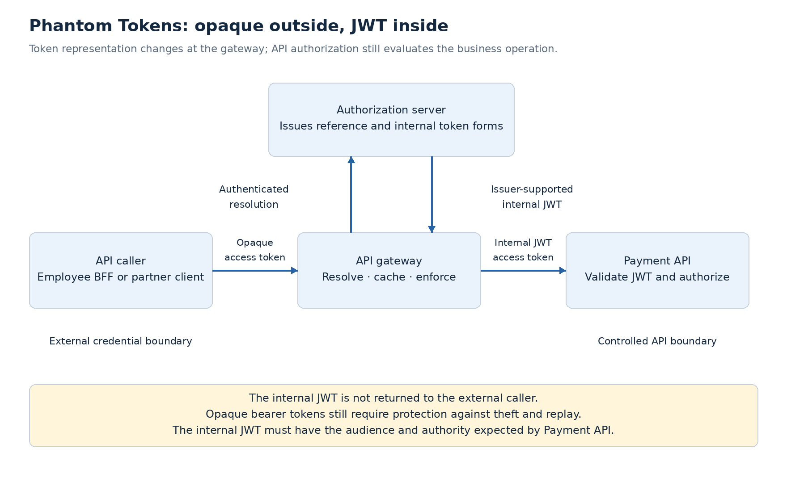
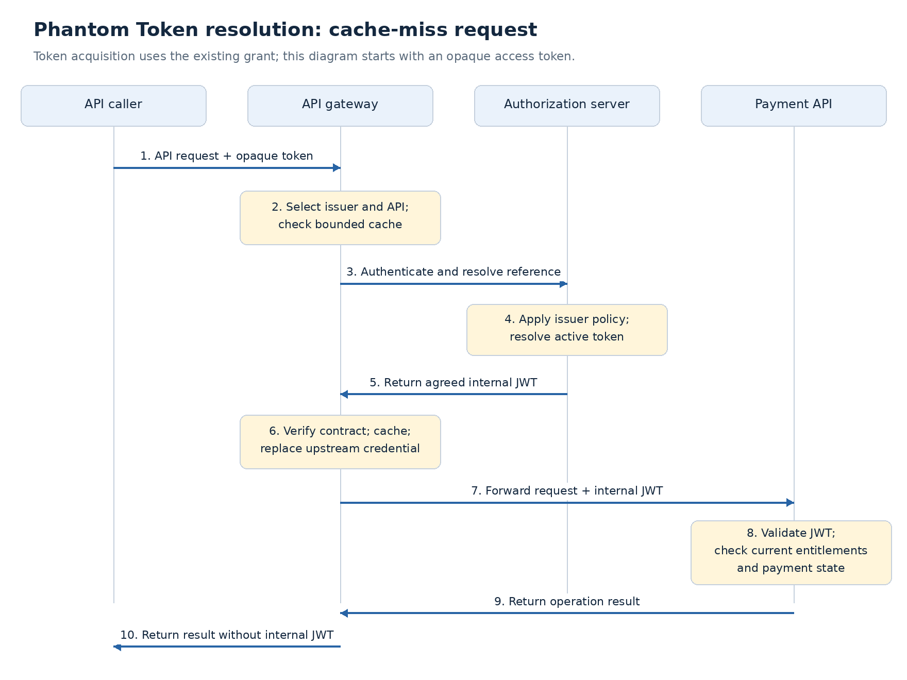

# Phantom Token Architecture

An externally issued JWT can expose internal identity and authorization claims to every client holding it. Signing protects integrity, but does not hide the payload. External clients can also become coupled to claims that were intended for backend services.

**The Phantom Token pattern keeps the external access token opaque and provides a signed JWT to APIs behind a controlled gateway.** Clients use a reference token; the gateway resolves that reference through an authorized integration with the authorization server.

For the claims platform, this is an optional token-exposure decision. Partner clients can receive opaque access tokens for Payment API calls. In the employee path, the BFF can hold the opaque token while the browser continues to use its session cookie. Neither path requires a new OAuth grant type.

## Establish the two token boundaries

| Boundary | Credential | Responsibility |
|---|---|---|
| Client to gateway | Opaque access token | Gateway verifies the reference through the configured issuer integration or a valid cached result. |
| Gateway to API | Internal JWT access token | API validates issuer, signature, audience, lifetime, and applicable token claims. |
| API authorization | Current business context | API evaluates account access, approval authority, separation of duties, and payment state. |

The opaque token is a credential, not a harmless identifier. If it is a bearer token, stealing it can still enable replay. **Opacity reduces claim exposure; it does not provide sender constraint.**

Internal JWTs also need protection. Keep them out of browser responses, external headers, logs, traces, and error messages. Network placement alone does not make a bearer token safe.

## Define the issuer–gateway contract first

[Curity's Phantom Token pattern](https://curity.io/resources/learn/phantom-token-pattern/) combines external reference tokens with internal JWTs. Its [introspection integration](https://curity.io/resources/learn/introspect-with-phantom-token/) can return a corresponding JWT using `Accept: application/jwt`, or include a JWT in a customized JSON response. This is a supported product contract, not behavior guaranteed by every authorization server.

Distinguish three response types:

| Response | Purpose | Can the gateway forward it as an API access token? |
|---|---|---|
| RFC 7662 JSON introspection | Reports token activity and associated metadata | No; the JSON object is token metadata. |
| RFC 9701 JWT introspection response | Protects introspection metadata in a JWT envelope | No; it is not an alternative access-token representation. |
| Issuer-supported Phantom Token response | Supplies the agreed internal JWT access token | Yes, when the downstream API explicitly trusts that token contract. |

[RFC 9701](https://www.rfc-editor.org/rfc/rfc9701.html) uses `application/token-introspection+jwt` and separates introspection metadata under `token_introspection`. Do not confuse that response with Curity's `application/jwt` integration. **JWT syntax does not determine token purpose.**

Before adopting this pattern, confirm:

- The issuer can issue opaque tokens and return an appropriate internal JWT.
- The gateway is authorized to resolve those tokens for the intended APIs.
- The internal JWT has an agreed issuer, audience, lifetime, scope representation, and subject/client identity semantics.
- The gateway and API preserve any required authentication context and sender-binding information.

Do not invent a gateway-issued JWT merely because the provider returns JSON introspection. Gateway signing creates a separate token issuer and trust architecture that needs its own design.

## Follow the request through the boundary

1. **Client obtains an opaque access token** through its existing grant: Authorization Code for the employee BFF or Client Credentials for a partner workload.
2. **Gateway receives the API request** and selects the configured issuer and target API. Token contents or caller-supplied URLs must not choose an arbitrary introspection endpoint.
3. **On a cache miss, gateway authenticates to the authorization server** and resolves the reference. The integration must establish token activity and return the agreed internal token.
4. **Gateway enforces its ingress checks** and replaces the upstream credential with the internal JWT. It strips conflicting identity headers supplied by external callers.
5. **Payment API validates the internal JWT** and evaluates the business operation using current entitlements and payment state.

The gateway's introspection credential is separate from the caller's access token. Protect and rotate it using the selected [client-authentication method](client-authentication-methods.md). An active reference does not prove that the token is suitable for every route; enforce the intended API audience and capabilities.

Resolution also does not guarantee freshly evaluated role or permission claims. The issuer may return the original token's claim snapshot. Keep current payment entitlements in the application's authorization decision unless the issuer contract explicitly provides the required freshness.

Avoid direct external access to the internal API. External routes must reject internal-token bypasses, and internal routes must have explicit workload access controls. If internal JWTs are accepted at a public gateway endpoint, the external reference-token boundary can be defeated.

## Cache for performance; bound the stale-acceptance window

Resolving every request adds authorization-server latency and load. Caching reduces that dependency, but extends the time during which an earlier successful result may be accepted after revocation.

**A proposed positive-cache bound is the earliest of:**

- The external reference token's known expiry.
- The internal JWT's expiry.
- The issuer's permitted cache lifetime.
- The platform's maximum acceptable status-staleness interval.

Do not extend cache validity merely because the JWT still validates. If a required expiry or cache bound is unavailable, use an explicitly conservative policy rather than assuming unlimited reuse. [RFC 7662](https://www.rfc-editor.org/rfc/rfc7662.html) describes the freshness trade-off introduced by introspection caching.

Partition cache entries by issuer, token reference, and any resource or resolution context that changes the result. Use a keyed digest of the token as a cache index where practical; the cached JWT remains sensitive and needs protected storage.

Bound negative caching, coalesce concurrent misses, and rate-limit invalid-token traffic. These controls prevent random token submissions from overwhelming introspection or growing the cache without limit.

For faster revocation, connect verified security events to affected cache entries and request-time restrictions. The [continuous access evaluation](continuous-access-evaluation.md) design still needs reliable correlation and propagation. Deleting a gateway cache entry does not invalidate an internal JWT already obtained elsewhere.

## Keep representation separate from delegation

| Pattern | Primary decision | Claims-platform example |
|---|---|---|
| BFF | Where browser tokens and sessions are handled | Browser uses a cookie; BFF retains tokens. |
| Phantom Token | Where token claims become visible | Gateway resolves a partner's opaque token to an internal Payment API JWT. |
| RFC 8693 token exchange | Whether a new token is issued under an exchange policy | Payment API obtains a Ledger API token with an appropriate audience and authority. |
| Sender-constrained tokens | Which presenter may use a token | Gateway verifies certificate or DPoP binding for the incoming request. |

Phantom Token resolution does **not automatically** reduce privileges, change audience, or establish an actor chain. An internal Payment API JWT must not be relayed to Ledger API unless Ledger is an intended recipient. Use the separately designed [downstream delegation and token exchange](downstream-delegation-token-exchange.md) contract when a new audience or authority is needed.

If the external token is sender-constrained, the gateway must verify the incoming proof or certificate binding. The downstream hop needs an explicit trust and binding arrangement; forwarding a browser-facing DPoP proof unchanged generally does not match the downstream request. Token resolution must not silently discard the protection established at ingress.

## Failure handling and adoption decision

| Condition | Expected behavior |
|---|---|
| Reference token is inactive or invalid | Reject with `401`; do not forward an internal credential. |
| Token lacks a required capability | Deny the operation; resolution must not add the missing authority. |
| Resolution is unavailable and no permitted cache result exists | Fail closed; return temporary unavailability rather than pretending the credential is invalid. |
| Gateway authentication or response contract fails | Treat as an integration incident; do not fabricate a replacement JWT. |
| A cached result exceeds its freshness bound | Resolve again or reject; do not silently extend stale acceptance. |

Monitor resolution latency, cache hit rate, authorization-server load, inactive-token responses, contract failures, and revocation-to-enforcement time. Test credential rotation and signing-key rotation independently. Preserve request correlation across the gateway without recording either token value.

**Use this pattern when external claim confidentiality and internal JWT processing justify gateway resolution and cache operations.** Direct JWT access remains a simpler option where minimal claims can safely be exposed and its revocation behavior meets requirements. Opaque tokens with API-side introspection are another option when services can own that dependency.

For our existing employee architecture, the BFF already keeps tokens away from browser JavaScript. Phantom Tokens would add protection at the BFF-to-gateway boundary and for partner clients; they are not a prerequisite for the BFF decision.

Keep adoption **proposed** until provider and gateway capabilities are verified. Do not assume the current Okta or a future Keycloak setup implements Curity's response contract. Add this as a selective variant of the existing enterprise lab, with checks for internal-JWT bypass, cache expiry, revocation, and resolution outage.

Apply the decision to the [claims employee-access deep dive](../deep-dives/security/claims-employee-access.md). Next, consolidate the topic coverage and proposed ADRs before returning to the lab.
