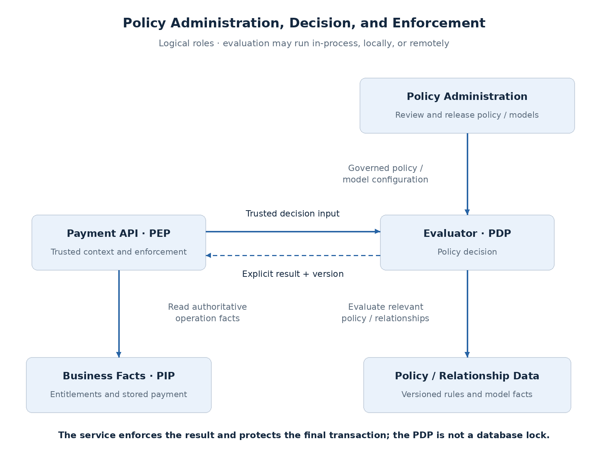
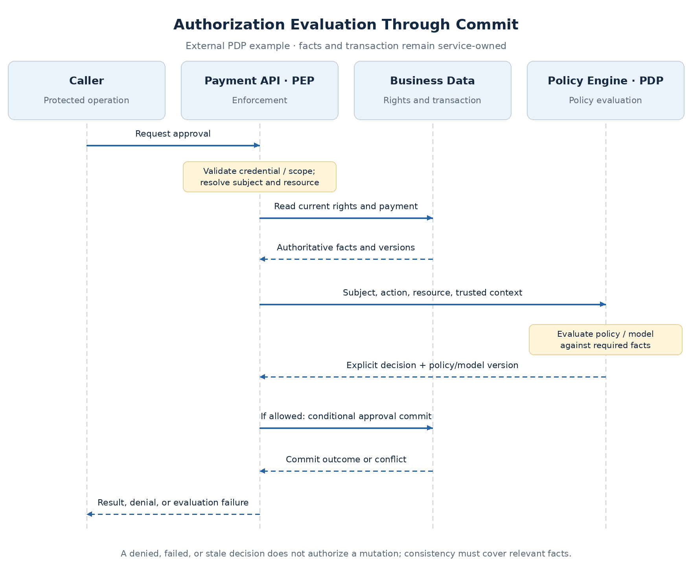

# Policy Decision and Enforcement Architecture

Authorization rules often begin inside a service. As more services need the same account rights, business conditions, or relationship model, copying those rules can produce inconsistent decisions and make changes difficult to review.

A policy architecture separates **evaluating access** from **enforcing the result**. That separation can exist inside one process or across services. Moving evaluation outside the application adds policy delivery, data consistency, and availability responsibilities; it is not automatically a stronger design.

The [authorization models](runtime-authorization-models.md) define what access means. This topic defines where decisions run and who supplies their facts.

## Assign the responsibilities

| Role | Responsibility | Claims example |
| --- | --- | --- |
| Policy Enforcement Point (PEP) | Intercept the operation, establish trusted context, enforce the result | Payment API protects approval and its commit |
| Policy Decision Point (PDP) | Evaluate policy against relevant facts | Application evaluator, local engine, or remote service |
| Policy Information Point (PIP) | Obtain authoritative attributes or relationships | Entitlement/resource data retrieval |
| Policy Administration Point (PAP) | Govern policy/model changes and delivery | Reviewed policy repository and release process |

These are **logical roles**, not a requirement to deploy four services. One component may perform several roles.

**The API remains responsible for enforcement.** An external allow result must not bypass resource-state checks, required conditions, or the final transaction boundary.

## Compare deployment choices

| Design | Benefit | Cost / limitation |
| --- | --- | --- |
| In-process evaluator | Low latency; direct access to service facts | Shared rule changes follow application/library releases |
| Local engine or sidecar | Low network latency; policy can evolve separately | Engine resources, rollout, readiness and policy freshness |
| Remote authorization service | Shared evaluation/model and independent lifecycle | Network and datastore dependencies; common failure domain |

A centrally governed policy can be **evaluated locally**. Central policy ownership does not require a remote call for every request. Conversely, a remote service does not guarantee consistent decisions if its inputs or caches are stale.

For a small claims service, a tested application evaluator is sufficient. Externalization becomes useful when shared policy, relationship complexity, or independent governance justifies the extra operating model.

## OPA and OpenFGA solve different parts of the problem

| Engine | Main approach | Natural claims use |
| --- | --- | --- |
| Open Policy Agent (OPA) | General-purpose policy evaluation over structured input and data | Approval rules involving amount, subject, action and context |
| OpenFGA | Authorization model plus relationship tuples and derived relations | Account/team/claim ownership and inherited resource rights |

OPA evaluates policy, commonly written in Rego. It does not automatically discover current business data: the application supplies input, or another governed integration makes data available to the engine. OPA can run locally or remotely. See [OPA deployment guidance](https://www.openpolicyagent.org/docs/deploy).

OpenFGA stores and queries a relationship model. Its checks answer whether a subject has a specified relation to an object, including derived access. Conditions can extend that model; it is not limited to unconditional graph membership. Its data updates, query consistency, and model lifecycle must be designed. See [OpenFGA models](https://openfga.dev/docs/configuration-language).

**Do not choose an engine from the label “fine-grained authorization” alone.** Compare required rules, relationship queries, authorized-object listing, source-of-truth integration, and operating cost. Combining engines may be possible but adds coordination and decision-composition complexity; the claims baseline does not need both.

## Define the decision contract

For an approval request, the PEP builds context from a validated identity and authoritative payment/entitlement data.

| Input | Trust requirement |
| --- | --- |
| Subject and calling client/actor | Derived from accepted credentials, not arbitrary headers |
| Action and resource | Determined by the protected operation and resolved resource |
| Amount, account, initiator, state/version | Persisted payment facts |
| Limits, permissions, relationships | Governed authorization data with known freshness |
| Assurance/environment | Verified source with defined meaning |

The PDP returns an explicit decision and sufficient safe metadata to trace its policy/model version. If a result includes conditions or obligations, the PEP must enforce them; it cannot reduce a conditional result to an unconditional Boolean.

Authenticate remote callers, authorize access to the appropriate policy/store, and protect service communication. A writable policy endpoint or caller-injected relationship can turn the authorization system into a privilege-escalation path.

## Follow evaluation through commit

The API gathers trusted facts, obtains a decision, and commits only while its required conditions hold. **A remote allow result is not a database lock.** Payment state, version, or account rights can change between evaluation and use.

Define a transaction, lock/version protocol, or other consistency arrangement covering the facts required at commit. A payment-version check protects payment edits but not every entitlement change. Keep the service-owned invariant checks close to the mutation and define valid ordering for concurrent access removal.

## Separate policy freshness from data freshness

- **Policy/model:** which rule version is active at each evaluator?
- **Authorization facts:** how current are entitlements and relationships?
- **Decision cache:** can a previous allow still be reused?

OPA bundles can distribute policies and data with eventual updates. A local evaluator may remain available during control-plane failure while using its last accepted bundle; define a maximum age and minimum required revision. A newly started engine without valid policy must not serve unchecked requests. See [OPA bundles](https://www.openpolicyagent.org/docs/management-bundles).

OpenFGA offers query consistency choices, including higher consistency that bypasses relevant caches. This does not make a relationship check atomic with the Payment API's database commit or update an upstream source that has not synchronized yet. See [OpenFGA query consistency](https://openfga.dev/blog/query-consistency-options-announcement).

Cache keys need the subject, action, resource, policy/model context, and relevant data versions. Permission removal must have a defined invalidation or expiry path. Sensitive approval must not inherit a read-cache policy by convenience.

## Failures and capacity

| Condition | Required behavior |
| --- | --- |
| PDP denies | Enforce denial |
| Timeout, malformed/undefined result, missing required facts | Do not treat as allow; return the appropriate evaluation failure |
| Local policy delivery interrupted | Use last accepted policy only within explicit freshness/readiness rules |
| Required engine unavailable | Sensitive action stops; no fallback to a broader rule |
| Old and new evaluators disagree during rollout | Identify versions; halt/rollback or use a controlled compatibility plan |

Remote evaluation adds latency and concurrent demand to every protected path. Size pools, timeouts, and engine/datastore capacity accordingly. Local engines trade remote hops for replicated CPU/memory and distribution work. Shared PDP or data stores need availability and isolation aligned with the services relying on them.

A single-object check and listing authorized resources have different cost profiles. Batch or authorization-aware query interfaces can reduce per-item calls, but must preserve visibility, pagination, and partial-result semantics. The [modeling page](runtime-authorization-models.md#protect-reads-as-well-as-mutations) defines those read boundaries.

## Roll out and observe policy changes

Treat policy/model changes as releases: review, regression-test allowed and denied cases, record versions, stage changes, and define rollback. New models may require data migration as well as code changes.

Shadow evaluation can compare a proposed policy with the enforced one. **Shadow results must not authorize traffic.** Restrict rollout comparisons to compatible versions and trusted, privacy-controlled inputs.

Measure decision latency, error rates, denials by safe category, cache behavior, bundle/model revisions, and data-update delay. Correlate decision IDs with business audit outcomes. Decision logs can contain sensitive input; mask or omit unnecessary fields before retention or export, as described in [OPA decision logs](https://www.openpolicyagent.org/docs/management-decision-logs).

## Proposed direction

Retain the **application evaluator and authoritative entitlements** for the initial claims milestone. ADR-004 remains proposed; external engine selection is deferred until requirements justify it.

Consider OPA for independently managed conditional rules and OpenFGA for a substantial relationship model. Validate their data and failure contracts before replacing in-process checks. Whichever deployment is selected, the Payment API owns enforcing the result and protecting the transaction.

Next: step-up authentication and authentication freshness—when valid identity and business permission are insufficient assurance for a sensitive operation.
