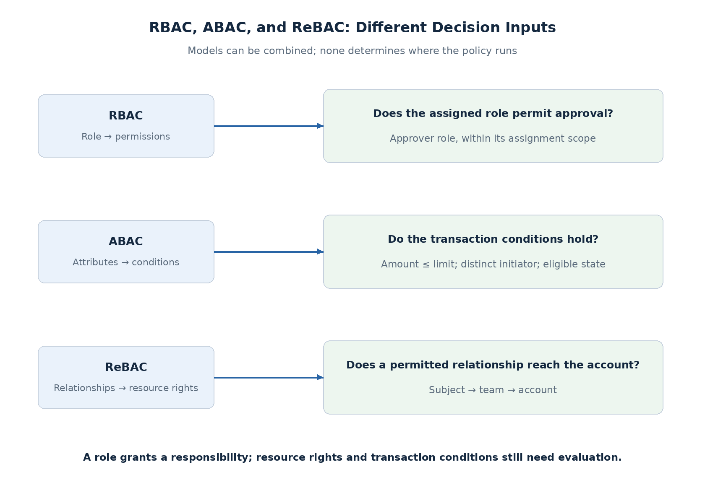
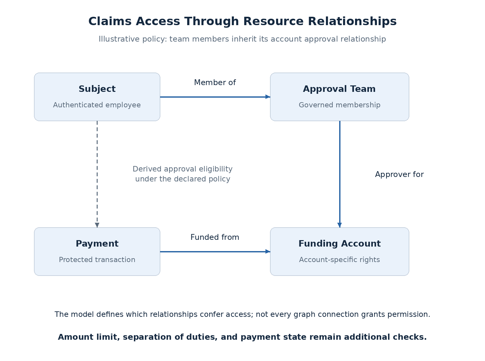

# Runtime Authorization: RBAC, ABAC, and ReBAC

A valid API token establishes trusted identity and granted capabilities. Business access depends on more: the subject's responsibility, its relationship to the resource, and the conditions of the requested action.

For a claims payment, an approver role is a useful starting point. It does not establish access to every account, an unlimited approval amount, or permission to approve one's own request. An authorization model makes those rules explicit and maintainable.

**RBAC, ABAC, and ReBAC are complementary modeling approaches.** They do not prescribe where policy executes or which product stores it.

## Choose the facts that govern access

| Model | Decision basis | Claims example | Main trade-off |
| --- | --- | --- | --- |
| Role-Based Access Control (RBAC) | Assigned roles and their permissions | Approver role permits the approval action | Simple responsibilities; exceptions can multiply roles |
| Attribute-Based Access Control (ABAC) | Subject, resource, action, and environment attributes | Payment amount is within the subject's limit | Expressive conditions; attribute trust and freshness matter |
| Relationship-Based Access Control (ReBAC) | Relationships connecting subjects and resources | Subject belongs to a team authorized for the funding account | Natural ownership/inheritance; graph changes and queries add complexity |

**Policy-Based Access Control (PBAC)** commonly describes expressing decisions through explicit policies. It is not necessarily another mutually exclusive model: a policy can combine roles, attributes, and relationships. Define the term when selecting a product rather than assuming one universal interpretation.

## RBAC: define business responsibilities

A role groups permissions such as read, create, approve, or audit. Users or workloads receive role assignments; requests are checked against those permissions.

| Role | Candidate permissions |
| --- | --- |
| Initiator | Read and create payments |
| Approver | Read and approve payments |
| Auditor | Read permitted records and audit evidence |
| Settlement workload | Execute approved payments |

Role assignments may be scoped to a business unit or account. **A global approver role should not imply access to every tenant.** The assignment's scope must be enforced.

RBAC fits stable job responsibilities. Avoid creating a new role for every combination of account, amount band, region, and exception. Those combinations make provisioning and reviews difficult; attributes or relationships often express them more directly.

Separation of duties also has two forms. Preventing incompatible role assignments is an administrative rule. Preventing the initiator of a particular payment from approving it is a runtime rule using that payment's facts.

## ABAC: evaluate the operation's conditions

ABAC evaluates facts about the subject, resource, action, and relevant environment. [NIST SP 800-162](https://csrc.nist.gov/pubs/sp/800/162/upd2/final) defines that model.

| Attribute source | Example facts |
| --- | --- |
| Subject | Approval limit, business-unit eligibility, account rights |
| Resource | Amount, funding account, initiator, state, sensitivity |
| Action | Read, approve, execute |
| Environment | Trusted authentication assurance, current time, validated device context where available |

A claims approval rule can require the amount to be within the subject's limit, the initiator to be different, and the payment to await approval. These constraints remain meaningful as roles and account assignments change.

**The attribute must be trustworthy, not merely present.** Use the persisted payment amount and account; do not let an approval request supply their authoritative values. Device posture or authentication assurance must come from a verified source, not a caller's assertion.

Missing or unavailable required attributes must not default to permission. Distinguish a known denial from an inability to evaluate, so the API can report the appropriate failure without approving.

## ReBAC: model access through relationships

Some rights follow ownership or membership rather than a fixed global role. A subject may be authorized through a team that has an approver relationship to an account. A payment belongs to that account, so its policy can inherit the relevant account relationship.

The graph describes facts; the policy defines which relationships confer which actions. **Membership alone does not imply every permission.** A read relationship must not become approval authority merely because both reach the same resource.

ReBAC fits account delegation, organizational hierarchies, and collaboration. Relationships can be direct or derived through other objects. Their ownership and update process must be governed, including whether moving a resource or changing a parent changes inherited access.

[OpenFGA's modeling documentation](https://openfga.dev/docs/configuration-language) illustrates relation definitions and derived access. The conceptual graph here does not require OpenFGA; it could initially be represented in application tables.

## Combine the models for payment approval

The claims design can use:

- **Scope gate:** the client grant permits `payment:approve`.
- **RBAC:** the subject has approval permission in the applicable business scope.
- **ReBAC or explicit entitlements:** the subject is authorized for the funding account.
- **ABAC:** amount, initiator, and state satisfy the approval conditions.

All applicable gates must pass. This is not a rule that every system must implement all three models. For the initial lab, explicit account entitlements can represent the relationship without deploying a graph service.

**Scopes remain client-grant controls; roles and resource facts govern business authority.** Their relationship is covered in [Scopes, Groups, and API Access Decisions](scopes-and-api-access.md), rather than duplicated as token claims in this model.

## Keep the decision consistent with the operation

Authorization data can change while a request is running. A policy engine does not remove that race.

For approval, evaluate authoritative entitlements and the stored payment, then use a transaction, lock, or version protocol that protects the relevant check-and-commit boundary. Checking the payment version alone does not protect concurrent changes to account permissions. Define which outcome is valid when removal and approval overlap.

If authorization facts are copied into tokens, cached, or replicated, define their permitted staleness and how updates reach enforcement. An immediately updated policy with stale data can still produce an outdated decision.

## Protect reads as well as mutations

Authorization must cover every access path, not only a single-object endpoint:

| Access path | Required boundary |
| --- | --- |
| Read one payment | Verify visibility of that object |
| List/search payments | Filter by permitted resources before returning data |
| Counts and aggregates | Avoid revealing records outside allowed visibility |
| Audit/export | Apply resource rights and permitted fields |
| Batch operations | Define per-item checks and atomicity/partial-result behavior |

A system that denies an individual payment but returns it through search still has a broken access boundary. Filtering after retrieving an unrestricted page can also produce incorrect pagination or counts. Authorization-aware query design belongs in the data access contract.

## Scaling, testing, and operations

RBAC lookups are often straightforward; ABAC can require several attribute sources; ReBAC may involve relationship traversal or authorized-object listing. Measure the actual access patterns. Checking a single object and listing thousands of permitted objects are different workloads.

Caching can reduce latency but must include the subject, action, resource, policy context, and relevant versions. Define how removed access invalidates or expires cached decisions. Bound remote lookups and avoid treating dependency failure as allow.

Test both permitted and denied cases: wrong account/tenant, changed limit, self-approval, removed membership, missing attributes, and concurrent updates. Version policy changes and record safe decision reasons so a denial can be traced to its rule and input versions. Avoid logging unnecessary personal or entitlement data.

## Proposed direction

Use **roles for stable responsibilities**, **attributes for transaction conditions**, and **relationships or explicit entitlements for resource access**. Introduce richer models when the business rules justify them, rather than encoding every exception as another role.

The current claims implementation choice remains application-owned entitlements and evaluation. The next topic compares in-process decisions with external policy engines, including PDP/PEP responsibilities, OPA, and OpenFGA. Model choice and deployment choice are separate decisions.

## Related documentation

- [OWASP authorization guidance](https://cheatsheetseries.owasp.org/cheatsheets/Authorization_Cheat_Sheet.html)
- [NIST attribute considerations](https://csrc.nist.gov/pubs/sp/800/205/final)
- [Gateway and API Enforcement Boundaries](gateway-api-enforcement.md)
