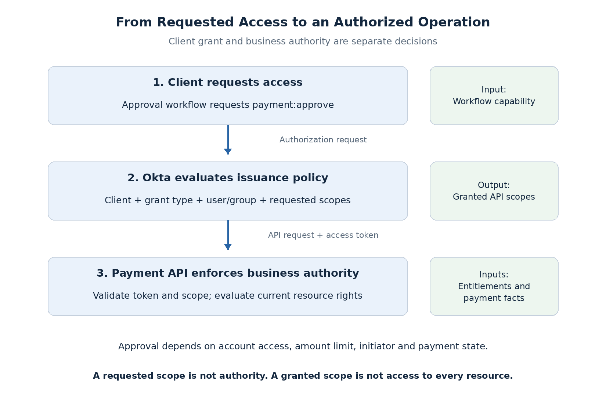

# Scopes, Groups, and API Access Decisions

An employee can have broad business authority while a particular application needs only part of it. The API must preserve both limits: the capabilities granted to the client and the subject's authority over the requested resource.

For the claims system, initiators create payments, approvers authorize them, and auditors review records. These responsibilities establish eligibility; the API still checks which payment and account the request concerns.

## Requested, granted, and permitted access

The client knows which capabilities its workflow needs before it knows who will sign in. After authentication, the authorization server evaluates that request against client and user policy.

| Decision | Owner | Approval example |
| --- | --- | --- |
| Requested access | Client | Requests `payment:approve` for the workflow |
| Granted access | Authorization server | Permits the request for this client and subject |
| Business authorization | Payment API | Evaluates current account rights and payment facts |

**Requesting a scope does not grant it. Receiving it does not authorize every resource.** The API enforces the actual grant and then the business rules.

## Define capabilities at a useful level

| Scope | Capability | API-owned restrictions |
| --- | --- | --- |
| `payment:read` | Read payment data | Business-unit/account visibility and response fields |
| `payment:create` | Create a payment request | Claim/account rights and allowed request attributes |
| `payment:approve` | Approve an eligible payment | Permission, account, limit, distinct initiator, state |

These action scopes are useful client boundaries. Encoding each account ID and amount band in scope strings would couple the grant vocabulary to frequently changing business data.

**Scope granularity is a design choice.** A scope need not be coarse, and a custom claim need not be fine-grained. The audience remains separate: `aud` identifies the intended API recipient, while scopes describe access capabilities.

## Use groups for issuance eligibility

| Eligibility group | Capability set |
| --- | --- |
| Payment Initiators | Read and create |
| Payment Approvers | Read and approve |
| Payment Auditors | Read |

Membership comes from a governed provisioning process. Registering an account does not automatically grant approval authority.

Two controls must remain distinct:

- **Application assignment:** may the user access this application?
- **Issuance policy:** may this client acting for this user receive the requested scopes?

Neither defines account-specific approval limits in this design.

## Configure the issuance boundary in Okta

Use a **custom authorization server** for the Payment API. Define the audience and scopes, then target access policies at the relevant client IDs. Rules evaluate grant type, user/group conditions, requested scopes, and token lifetime.

| Configuration | Purpose |
| --- | --- |
| Client registration | Application identity and supported OAuth behavior |
| Application assignment | Employee access to the application |
| Server audience and scopes | API recipient and capability vocabulary |
| Access policies and rules | Grant eligibility and token lifetime |

Okta applies the **first matching policy/rule** in priority order. It does not merge all matching group rules. Multiple-group users need rules that support the intended scope combinations. An unmatched request can fail; do not assume unauthorized scopes are silently removed.

A broad fallback rule can undo these restrictions. Review rule priority and test both allowed and denied combinations. Exact console steps belong in the lab guide; [Okta's policy documentation](https://developer.okta.com/docs/guides/configure-access-policy/-/main/) defines the behavior.

## Why a group does not replace the client grant

An approver uses two applications:

| Application | Same user's membership | Granted scopes |
| --- | --- | --- |
| Reporting dashboard | Payment Approvers | `payment:read` |
| Claims application | Payment Approvers | `payment:read`, `payment:approve` |

If the API authorizes solely from the group, the reporting token could approve payments despite its read-only grant. **User authority must not erase the restriction on the calling application.**

Group-based authorization is still viable. An access token can carry filtered groups or roles, provided the API retains explicit client restrictions and defines how membership changes take effect. Use the API access token; the [ID token has a different recipient and purpose](content.md#oauth-20-and-openid-connect).

## Decide when to request capabilities

| Approach | Benefit | Cost |
| --- | --- | --- |
| Request workflow scopes at login | Fewer redirects | Requests access before it is needed; policy must permit the combination |
| Request additional scopes when entering a workflow | Narrower initial grant | Another authorization flow and grant-state handling |
| Broad API scope plus business permissions | Stable scope vocabulary | Client-operation restrictions must be explicit elsewhere |

The claims design proposes **read access at login**, followed by create or approve access for the relevant workflow. A new request includes the capabilities needed afterward; it must not assume scopes from separate grants are automatically combined. A denied upgrade must leave any retained session and grant in a safe, defined state.

**Incremental authorization requests more access. Step-up authentication requires stronger or more recent authentication.** One does not establish the other.

## Keep business authority in the application

The baseline requires no custom business-role or approval-limit claims. Okta can use groups during issuance without including them in the token. The API maps the validated **issuer + subject** to application-owned permissions and entitlements.

For approval, use current account authority and the persisted transaction. The client cannot supply an authoritative approval amount, initiator, or account ownership. Removing account entitlement can block approval while the scope-bearing token remains valid.

Custom permission claims are an alternative when their freshness window is acceptable. Already-issued claims are a snapshot. They still need resource facts, and large per-resource entitlement lists can increase token size and couple identity configuration to application data.

Sensitive checks also need consistent data access: reading a lagging replica or cached entitlement may preserve removed authority. Protect the final decision against concurrent entitlement and payment changes when committing the operation; a fresh read alone is insufficient.

## Proposed decision

Use **action scopes for client capabilities**, **groups for issuance eligibility**, and **current application entitlements for resource authority**. These are complementary controls with separately owned data.

Next: [Browser Token and Session Architecture](browser-session-architecture.md).

## References

- [Okta authorization servers](https://developer.okta.com/docs/concepts/auth-servers/)
- [Okta scopes, policies, and claims](https://developer.okta.com/docs/guides/customize-authz-server/-/main/)
- [OAuth access-token scope](https://www.rfc-editor.org/rfc/rfc6749.html#section-3.3)
