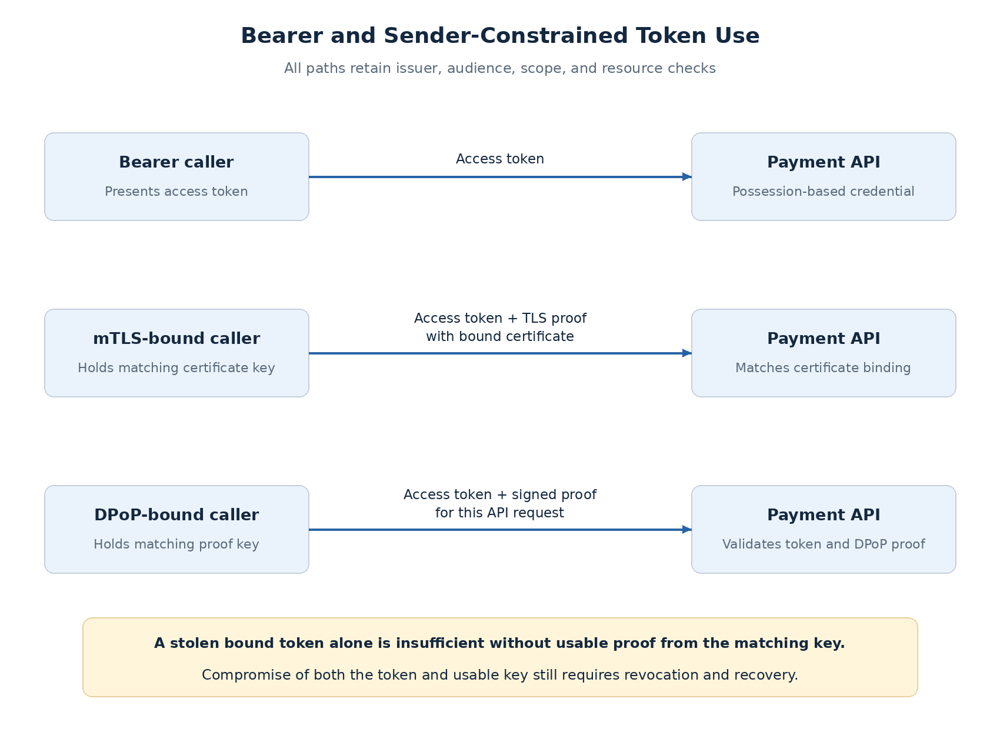
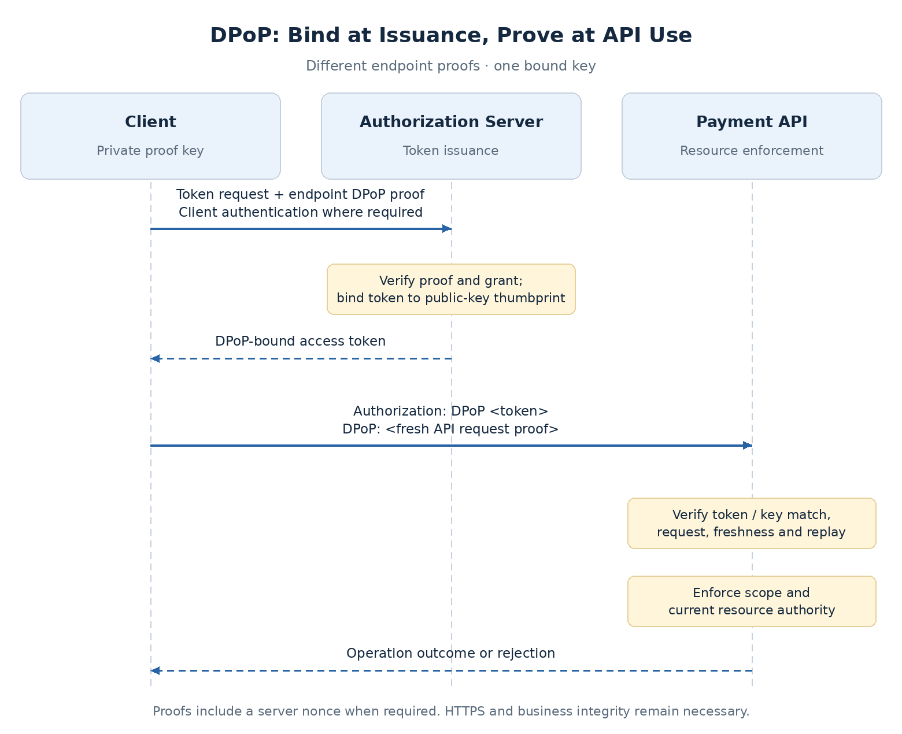

# Sender-Constrained Tokens: mTLS Binding and DPoP

A stolen bearer access token can be presented by another caller until the API rejects it through expiry, revocation, or another control. Strong client authentication during issuance does not prevent this: the attacker may steal the issued token without stealing the original authentication credential.

**Sender constraints bind token use to a key.** The API requires both the token and proof that the caller possesses the bound key. This limits the value of a stolen token, while adding key lifecycle and verification responsibilities.

## Separate authentication from token binding

| Control | Question answered |
| --- | --- |
| Client authentication | Which client is requesting a token from the issuer? |
| Sender constraint | Does this API caller possess the key bound to the token? |
| Resource authorization | May the represented authority act on this resource? |

[Client authentication](client-authentication-methods.md) and sender constraints can use related keys, but they are distinct controls. **Neither replaces issuer/audience validation, scope checks, current entitlements, or revocation.**

## Compare the token-use models



| Model | API requires | Suitable context | Added responsibility |
| --- | --- | --- | --- |
| Bearer | Accepted access token | Systems whose threat model accepts possession-based use | Protect token exposure and define revocation/expiry |
| mTLS-bound | Token plus TLS proof using matching certificate key | Controlled workloads and partner certificate environments | Certificate lifecycle and trustworthy TLS termination |
| DPoP-bound | Token plus signed request proof from matching key | Supported browser, native, or backend clients | Proof validation, replay controls, URL handling and key lifecycle |

Both sender-constrained designs still require HTTPS. They do not encrypt the token or remove its confidentiality requirements.

## mTLS certificate-bound tokens

The issuer binds the access token to the certificate presented during issuance. The resource server checks that the certificate used on the API connection matches that binding.

For JWT access tokens, the confirmation typically appears as:

```json
{
  "cnf": {
    "x5t#S256": "<certificate-thumbprint>"
  }
}
```

The thumbprint identifies the certificate, not merely its issuing CA. A different trusted certificate must not satisfy the binding. The same information can be conveyed through authenticated introspection for an opaque token.

**mTLS at the token endpoint alone is insufficient.** The issuer must issue a bound token, and the API boundary must verify the corresponding key possession. [RFC 8705](https://www.rfc-editor.org/rfc/rfc8705.html) defines these separate mechanisms.

If a gateway terminates client TLS, it owns the observed certificate evidence. Either enforce binding there with a protected gateway-to-service contract, or securely propagate the verified evidence to the enforcing service. Caller-supplied certificate headers cannot stand in for a successful handshake.

## DPoP: proof at the HTTP layer

DPoP stands for **Demonstrating Proof of Possession**. The client signs proofs with a private key. The issuer binds the token to the public-key thumbprint, commonly represented as `cnf.jkt`.

When accessing the API, the client sends:

```http
Authorization: DPoP <access-token>
DPoP: <signed-proof-jwt>
```

The proof is a separate JWT, not the access token. Its public key allows signature verification; the token binding establishes whether that key is the authorized one.

| Proof element | Purpose |
| --- | --- |
| `htm` | Bind to HTTP method |
| `htu` | Bind to target URI, excluding query and fragment |
| `ath` | Bind API proof to the presented access token |
| `iat` / `jti` | Establish freshness and distinguish proofs for replay handling |
| `nonce`, when required | Incorporate the server's freshness challenge |

Validate the proof type and allowed asymmetric algorithm, signature, token-key match, request method/URI, token hash, and applicable freshness/replay requirements. A valid self-signed proof with an unrelated key must fail.

**DPoP does not sign the request body or query parameters.** TLS, input validation, business rules, and transaction integrity still protect the payment details. See [RFC 9449](https://www.rfc-editor.org/rfc/rfc9449.html).

## Issuance and protected requests



At issuance, the proof targets the token endpoint. At API use, a fresh proof targets the API method and URI and includes the access-token hash. These proofs are not interchangeable. DPoP may be used by public or confidential clients; confidential-client authentication remains a separate requirement.

An issuer or API can require a nonce and challenge the client to supply a new proof. The two endpoints' challenges must be handled correctly. Do not weaken enforcement after a missing or invalid proof; a bound token must not fall back to bearer acceptance.

## Replay, proxies, and downstream calls

**Proof validation must be consistent across instances.** Design replay tracking and freshness windows so a duplicate cannot simply reach another gateway or API instance. This can add shared state, coordination, memory use, and another failure mode.

Reverse proxies complicate URI verification. The verifier must use the intended external method/URI under the protocol's matching rules, with trusted forwarding configuration. Arbitrary forwarded headers must not let a caller choose which URI is considered valid.

Sender-bound tokens also change [token relay and exchange](downstream-delegation-token-exchange.md). A BFF holding the bound key can prove possession; another service cannot blindly relay the token and produce that proof. Define the new downstream grant and its binding when exchanging tokens. Neither relay nor exchange automatically preserves usable sender constraints.

## Rotation and failure behavior

A certificate-bound token references the **exact certificate thumbprint**. Renewing a certificate can change the binding even when its public key remains the same. Plan new token acquisition and a controlled old-certificate overlap where permitted.

A DPoP token references the proof key. Rotating that key normally requires new bound tokens. Protect keys against both extraction and unauthorized signing; a non-exportable key does not stop compromised code from invoking permitted signing operations.

| Failure | Required behavior |
| --- | --- |
| Token stolen without bound key | Reject missing or mismatched possession proof |
| Token and usable key both compromised | Sender constraint alone is insufficient; revoke access and recover credentials |
| Replay or wrong method/URI/token hash | Reject proof |
| Required nonce or replay validation unavailable | Follow explicit failure policy; no unchecked acceptance |
| Certificate/key changes while old tokens remain | Acquire matching tokens; do not disable binding to restore service |
| Business mutation response times out | Use reconciliation/idempotency; proof replay protection is not business deduplication |

Count binding mismatches, proof freshness/replay failures, nonce challenges, certificate expiry, and key-rotation errors separately from scope/business denials. Correlate safe diagnostic metadata without logging tokens, proofs, or private keys.

## Decision guidance

For claims access, consider **mTLS-bound tokens for controlled partner/workload connections** when certificate automation and termination are reliable. Consider **DPoP where supported** when application-layer possession proof is a better fit than client certificates.

The employee BFF already reduces browser token exposure. Adding sender constraints can address theft from other parts of its token path, but does not justify returning tokens to browser code or remove the need for session protection.

Before adoption, verify issuer, client library, gateway, and API support together. Demonstrate rejection of a stolen token from a different key, rotation continuity, replay handling, and safe failure behavior. **No sender-constraint implementation is claimed yet.**

Next: runtime authorization models and policy engines—how RBAC, ABAC, and relationship-based decisions use the trusted identity established by these controls.

## Related documentation

- [OWASP OAuth security guidance](https://cheatsheetseries.owasp.org/cheatsheets/OAuth2_Cheat_Sheet.html)
- [Client Credentials and Machine Identity](client-credentials-machine-identity.md)
- [JWT Validation, Introspection, and Revocation](token-validation-revocation.md)
