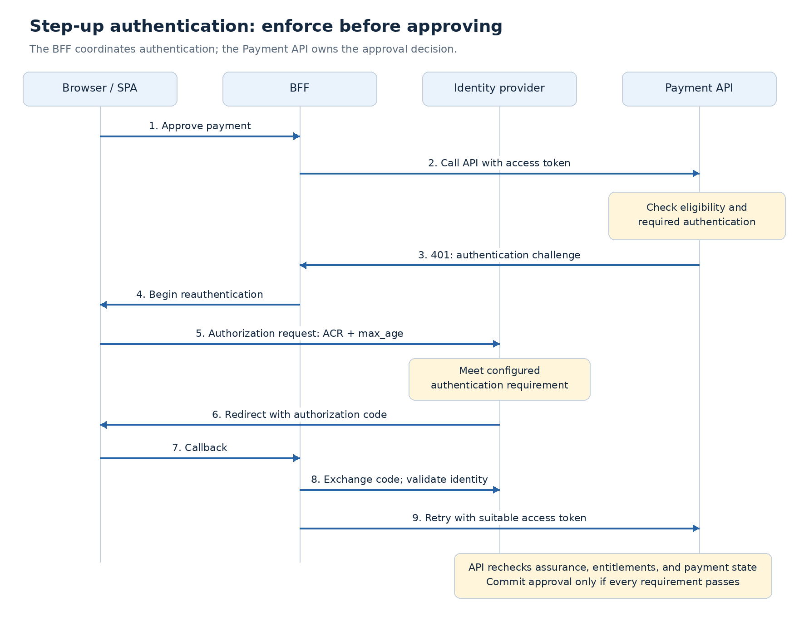
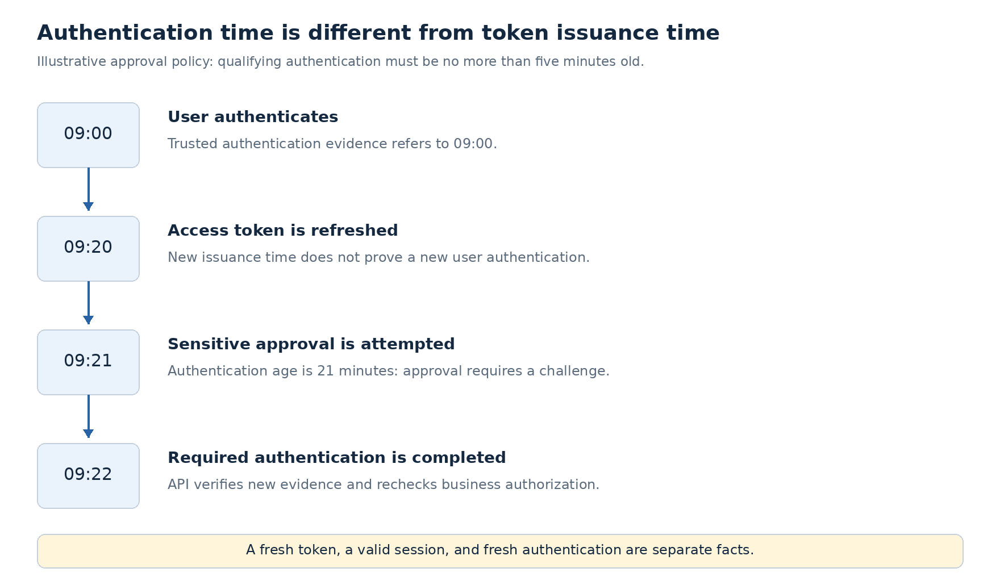

# Step-Up Authentication and Authentication Freshness

A user can be signed in and authorized to approve a payment while the authentication behind that session is too weak or too old for the operation. A valid access token establishes neither recent user interaction nor sufficient authentication assurance by itself.

**Step-up authentication requires the subject to meet an additional authentication requirement before a sensitive operation proceeds.** It changes the evidence supporting access; it does not create business permission.

In the claims platform, routine payment review can use the existing session. A sensitive approval can require a recent authentication event using an accepted phishing-resistant method. The Payment API decides when that requirement applies; the BFF coordinates the interaction with the identity provider.

## Separate the four decisions

| Decision | Question | Claims platform example |
|---|---|---|
| Scope gate | Can this client use this API capability with this token? | The token grants `payment:approve`. |
| Business authorization | May this subject approve this payment now? | The approver has access to the account, sufficient approval authority, and did not initiate the payment. |
| Authentication assurance | Does the authentication meet the accepted security policy? | The subject authenticated through a configured phishing-resistant method. |
| Authentication freshness | Was the required authentication recent enough? | The qualifying event occurred within the last five minutes. |

The five-minute window is **an illustrative policy choice**, not an OAuth requirement or an access-token lifetime.

Requesting another scope is incremental authorization. Requiring another authentication event is step-up. The two can occur together, but one does not prove the other.

**An approver who exceeds their approval limit remains denied after MFA.** Check business eligibility before prompting where practical, then check it again before committing the operation.

## Establish an authentication-context contract

The identity provider and API must agree on what constitutes acceptable authentication and how the API receives trustworthy evidence.

| Field | Meaning | Design implication |
|---|---|---|
| `acr` | Authentication context class reference | Accept explicitly configured classes; do not assume values form a universal numerical hierarchy. |
| `amr` | Authentication methods used | Useful evidence, but a factor list alone does not define the platform's assurance policy. |
| `auth_time` | Time of the user's authentication | Evaluate the relevant authentication age against the operation's requirement. |
| `iat` | Token issuance time | A newly issued token does not necessarily represent a new authentication event. |

OIDC defines `acr_values` and `max_age` for authorization requests. When `max_age` is requested, the ID token must include `auth_time`. This is an ID-token guarantee; APIs need their own agreed access-token or introspection contract. See [OIDC Core](https://openid.net/specs/openid-connect-core-1_0.html).

For this architecture, require issuer-authenticated assurance and freshness information in the API's access token or supported introspection response. Validate the token before using those fields. **Do not send the ID token to the Payment API as a substitute.**

Treat missing required evidence as an unmet requirement. Reject invalid timestamps and define an explicit, small clock-skew allowance. An API should not infer assurance from a browser flag or an untrusted request header.

## Challenge at the API; coordinate at the BFF



[RFC 9470](https://www.rfc-editor.org/rfc/rfc9470.html) defines an API challenge using `insufficient_user_authentication`, with `acr_values` and/or `max_age`. The client requests the indicated authentication requirements and retries with a suitable access token.

An illustrative response is:

```http
HTTP/1.1 401 Unauthorized
WWW-Authenticate: Bearer error="insufficient_user_authentication", acr_values="urn:example:auth:phishing-resistant", max_age="300"
```

The ACR identifier above is illustrative. Replace it with a value supported by the configured provider and accepted by the API.

In the BFF architecture:

1. **Payment API:** validate the token, load the payment, evaluate eligibility, and assess the operation's authentication requirement. Return a challenge before changing payment state.
2. **BFF:** recognize the challenge from the expected API, retain bounded continuation state, and initiate Authorization Code with PKCE through the browser.
3. **Identity provider:** perform authentication according to its configured policy. If existing authentication already satisfies the requirement, an additional prompt may be unnecessary.
4. **BFF:** validate the callback, `state`, nonce, and returned identity. Require the same issuer and subject as the session that started approval; reject account switching during continuation.
5. **Payment API:** validate the new access token and repeat authentication, entitlement, and payment-state checks before committing approval.

The browser continues to hold a secure session cookie; the BFF retains tokens. Protect the initiating and resumed operations against CSRF. Restrict challenges to supported requirements and a configured authorization server rather than accepting arbitrary redirect destinations.

**The API remains the enforcement point.** A UI prompt or successful BFF login does not establish that the token presented to the API satisfies its policy.

## Fresh tokens versus fresh authentication



Suppose the user authenticated at 09:00. A refresh at 09:20 produces an access token with a new `iat`, but it does not itself establish a new user authentication event. A sensitive operation requiring authentication within five minutes must still challenge if its trusted evidence refers to 09:00.

Avoid using `prompt=login`, token expiry, or successful refresh as the API's proof of freshness. The decision must use trustworthy authentication evidence. Keep baseline and elevated token/session handling explicit so concurrent browser requests cannot accidentally reuse an unsuitable token.

## Resume the operation safely

An approval may change while the user is authenticating. Another approver might act, the payment amount might change, or the subject's entitlement might be removed.

Before resuming:

- Bind continuation state to the **session, subject, payment, intended action, and expiry**. Avoid storing arbitrary callback URLs or trusting browser-supplied authorization results.
- Re-read the payment and current entitlements. Re-evaluate separation of duties and approval limits.
- Apply expected-version or transactional checks so a decision about an earlier payment state cannot approve a changed payment.
- Use idempotency controls for the approval command. Authentication redirects must not turn a retry into a duplicate business action.

If the payment changed materially, return the user to review rather than automatically approving the new state.

**Step-up is not transaction signing.** Recent strong authentication does not cryptographically bind the user to a particular amount or beneficiary. Explicit transaction confirmation or signing requires a separate design.

## Failures and operational behavior

| Condition | Expected behavior |
|---|---|
| Subject lacks business permission | Deny with `403`; do not offer MFA as a remedy. |
| Authentication requirement is unmet | Challenge with `401`; perform no approval mutation. |
| User cancels or provider cannot satisfy the requirement | Leave the payment unchanged and return an actionable result. |
| Retried token still lacks required evidence | Stop automatic retries; surface the contract or configuration failure. |
| Required policy or identity dependency is unavailable | Fail the sensitive operation closed; report temporary unavailability where appropriate, rather than a false permission denial. |

Record challenge reason, policy version, operation, outcome, and correlation identifier. Monitor completion latency, cancellation, repeated challenges, and failures after successful provider authentication. Never log tokens, cookies, or authentication secrets.

Risk signals can trigger stricter requirements, but device or network signals need trusted provenance. A continuously updated risk policy is a later extension; this design first establishes deterministic operation-level enforcement.

## Provider configuration and architecture decision

For Okta, configure supported ACR values, authenticator enrollment, and application authentication policies. Verify the actual assurance and freshness information available to the Payment API. The [Okta step-up guide](https://developer.okta.com/docs/guides/step-up-authentication/main/) describes provider-specific behavior; scope and group assignments alone do not establish this contract.

**Proposed design:** the Payment API owns sensitive-operation requirements; the BFF coordinates reauthentication; the API verifies issuer-authenticated evidence and repeats business authorization before approval. Adoption requires evidence that the provider, BFF, gateway, and API preserve the challenge and authentication context correctly.

Keep this as a concept page under Application & API Security. Apply its decision to the [claims employee-access deep dive](../deep-dives/security/claims-employee-access.md). Add selected assurance, freshness, and cancellation checks to the existing enterprise lab when implementation resumes.

Next: continuous access evaluation—how account, session, and risk changes affect access after tokens have already been issued.
