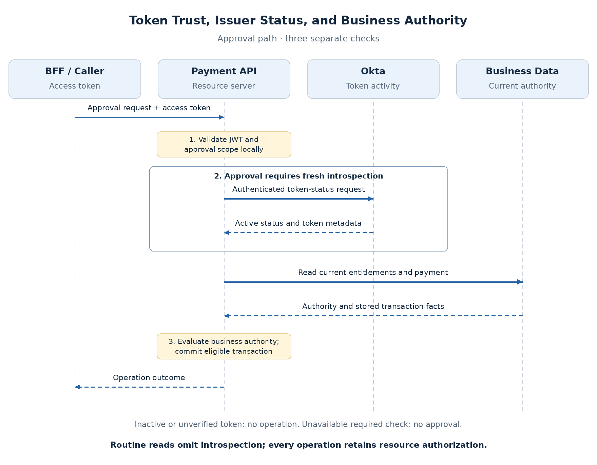

# JWT Validation, Introspection, and Revocation

A token can remain correctly signed after it has been revoked. It can also be active while the subject has lost access to a funding account. The API therefore needs to distinguish **token trust, issuer activity, and current business authority**.

## What each check establishes

| Check | Establishes | Does not establish |
| --- | --- | --- |
| Local JWT validation | Signature, trusted issuer, intended recipient, and time constraints | Current issuer revocation status |
| Introspection | Issuer-reported token activity and metadata at checking time | Current application-owned rights |
| Business authorization | Authority for this operation/resource | Token provenance by itself |

**Decoding is not validation.** Use claims as trusted inputs only after verification.

## Verify the local token contract

For the Okta custom-server access token:

- **Signature/algorithm:** use trusted issuer keys and an allowed algorithm.
- **Issuer (`iss`):** match the configured authorization server.
- **Audience (`aud`):** require the Payment API recipient.
- **Time:** enforce expiry and applicable validity claims with bounded clock skew.
- **Required claims/capability:** check scopes and any explicit client restrictions.

Use a maintained verifier and trusted discovery/JWKS configuration. Unverified token contents must not choose arbitrary issuers or key URLs. Reject ID tokens using the [recipient and purpose contract](content.md#oauth-20-and-openid-connect).

**JWKS is the issuer's signing-key set.** A token's `kid` selects a candidate key within that trusted set; it is not proof of trust. Cache keys, refresh in a bounded manner for an unknown key, and never accept a token whose signature cannot be established.

During normal rotation, retain valid previously published verification keys according to issuer and cache policy while learning new ones. Key removal after compromise can require faster invalidation. Do not assume indefinitely cached keys remain trustworthy.

## Check issuer activity through introspection

The API authenticates to the issuer's introspection endpoint. An inactive response can be:

```json
{"active": false}
```

**`active: true` permits further evaluation, not every business action.** Audience, capability, and current resource authority still apply.

The client-authentication arrangement is provider-specific. Okta documents that confidential clients can introspect other clients' tokens within the same authorization server, even without a token-issuance access policy. This supports a separate API-validation client instead of sharing the BFF credential. Its visibility is broad, so protect it accordingly and validate the actual configuration. Public clients are restricted to their own tokens. See [Okta cross-client introspection](https://support.okta.com/help/s/article/introspect-is-possible-with-a-client-that-is-not-assigned-to-the-authorization-server?language=en_US).

## Revocation, expiration, and logout

Suppose a token expires at **11:00** and is revoked at **10:15**:

- **Local-only verification** may still accept its signature/time claims until expiry.
- **Fresh introspection** detects inactivity once the issuer reflects revocation.
- **Current entitlements** independently deny operations after account authority is removed.

Revocation changes issuer state, not the token bytes. [Okta validation guidance](https://developer.okta.com/docs/guides/validate-access-tokens/) distinguishes local and remote checks.

Portal logout, Okta SSO termination, and token revocation have separate effects. Okta documents that revoking a refresh token also revokes associated access tokens; local verification still needs a status mechanism to observe that before expiry. See [revocation behavior](https://developer.okta.com/docs/guides/revoke-tokens/-/main/).

## Select a validation strategy

| Strategy | Benefit | Cost |
| --- | --- | --- |
| Local JWT checks | Low latency; no issuer call on each normal request | Revocation needs another mechanism or expiry |
| Per-request introspection | Fresh issuer-status check | Latency, provider rate limits, and availability dependency |
| Cached introspection | Lower remote load | Stale-active acceptance window |
| Selective introspection | Fresh checks on sensitive operations | Explicit operation-specific policy |

For claims access, propose **local checks everywhere plus uncached introspection for approval**, followed by current business authorization.



Acceptance requires proven introspection credentials and measured approval latency/load. This is a case-specific trade-off, not a universal requirement for every API.

## Keep the three caches distinct

| Cache | Information | Freshness concern |
| --- | --- | --- |
| JWKS | Signing keys | Rotation/removal policy; no individual revocation status |
| Introspection | Token activity | Revocation may remain undetected within cache lifetime |
| Entitlements | Business rights | Removed authority may persist until refreshed |

A 60-second active-status cache can preserve acceptance for almost 60 seconds after revocation. **Never cache an active result beyond token expiry.** [RFC 7662](https://www.rfc-editor.org/rfc/rfc7662.html) describes the freshness trade-off.

## Handle failures explicitly

| Failure | Proposed behavior |
| --- | --- |
| Okta unavailable; usable cached key verifies token | Routine reads can pass token checks; resource checks still apply |
| Unresolved key and unavailable JWKS | No operation; report inability to validate |
| Required approval introspection times out | Availability error; no local-only fallback |
| Introspection reports inactive | Reject credential, normally `401` |
| Token active, account entitlement removed | Deny business operation |

Bound refresh, introspection timeouts, and retries to avoid load amplification. Monitor key-refresh errors, introspection latency, provider failures, and inactive-token rejections separately from business denials. Never log tokens or validation credentials.

## Proposed decision

**Local checks establish token trust; introspection adds issuer status; resource checks establish business authority.** Each has its own owner and freshness requirements.

Fresh introspection is a point-in-time result, not atomic with a later revocation. Enforcement delay depends on issuer propagation, checking frequency, and caches. The [claims deep dive](../deep-dives/security/claims-employee-access.md) assembles these choices and their proposed ADRs.
